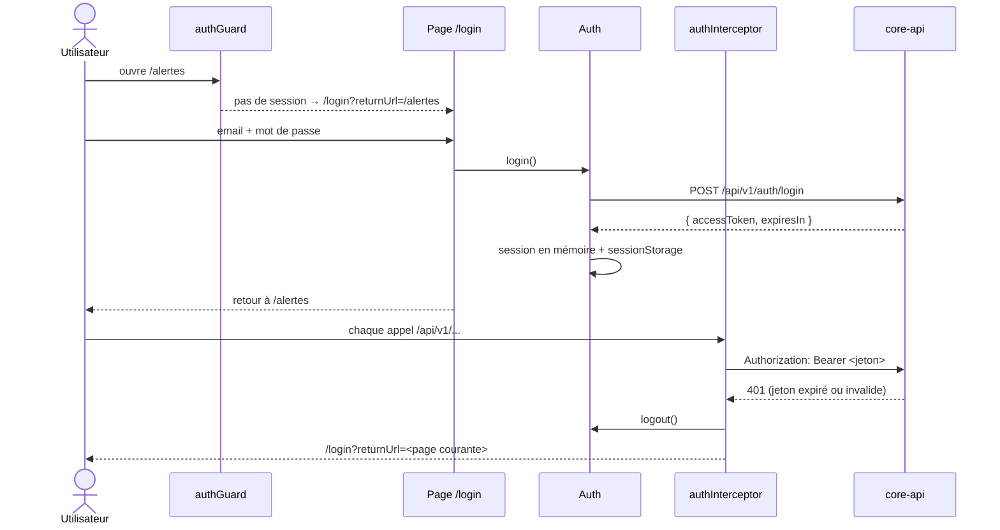

# Connexion

Le front s'authentifie auprès de core-api par jeton JWT. Le fonctionnement côté API (émission du jeton, rôles, visibilité des sites) est décrit dans la [documentation de core-api](https://github.com/enervision-project/smart-energy-optimizer/blob/main/services/core-api/docs/securite.md).

## Parcours

## Composants

| Fichier | Rôle |
|---|---|
| `core/services/auth.ts` | Session : `login()`, `logout()`, `token()`, `me()` (utilisateur courant via `GET /users/me`). Signal `loggedIn` pour l'affichage. |
| `core/interceptors/auth-interceptor.ts` | Ajoute `Authorization: Bearer …` aux appels `/api/v1` (sauf le login). Sur une réponse 401 : ferme la session et renvoie vers `/login`. |
| `core/guards/auth-guard.ts` | Appliqué à toutes les routes enfants de `app.routes.ts` : sans session valide, redirige vers `/login?returnUrl=…`. |
| `features/login/` | Formulaire de connexion, messages d'erreur, retour à la page demandée. |
| `app.ts` | Nom de l'utilisateur et bouton « Se déconnecter » ; badge des alertes interrogé seulement une fois connecté. |

## Choix

- **Stockage du jeton : `sessionStorage`.** La session survit au rechargement de la page, mais se termine à la fermeture de l'onglet. Le jeton et sa date d'expiration (calculée à partir de `expiresIn`) sont stockés ensemble ; un jeton expiré ferme la session sans appeler l'API.
- **Pas de renouvellement automatique.** Le jeton dure `JWT_EXPIRATION` (1 h par défaut) ; ensuite, la prochaine navigation ou le prochain appel renvoie vers la connexion, puis vers la page en cours.
- **Retour après connexion limité à l'application.** `returnUrl` n'est suivi que s'il commence par `/` (pas `//`) : impossible de rediriger vers un autre site.
- **Mode mock : pas de connexion.** Avec `npm start`, il n'y a pas de back : le jeton `AUTH_ENABLED` vaut `false`, le guard laisse tout passer et la page `/login` l'indique.
- **Droits par site : côté API.** Le front affiche ce que l'API renvoie ; c'est core-api qui limite un utilisateur `USER` à ses sites.

## Tester en local contre l'API

Voir le [README](https://github.com/enervision-project/smart-energy-optimizer/blob/main/app/web/README.md#lancer-en-local) : `docker compose up -d --build core-api`, puis `npm run start:api`.
