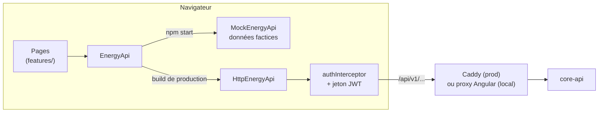

# Architecture du front

Application Angular 22 : composants standalone, signals, détection de changement sans zone.js. Le front ne parle qu'à core-api ; il ne connaît ni la base ni l'API Mock de l'école.

## Pages

| Route                  | Page             | Données                                                                                                                                                                                                  |
| ---------------------- | ---------------- | -------------------------------------------------------------------------------------------------------------------------------------------------------------------------------------------------------- |
| `/login`               | Connexion        | `POST /auth/login`                                                                                                                                                                                       |
| `/parc`                | Vue du parc      | Consommation actuelle et charge du parc, avertissement des sites sans données, courbe des 24 dernières heures, alertes de la dernière heure, sites triés par charge ; rafraîchis chaque minute           |
| `/sites`, `/sites/:id` | Détail d'un site | Site, et profil, dernière mesure, courbe brute / imputée avec la qualité de chaque pas, état des capteurs, synthèse ; rafraîchis chaque minute; mesures horaires et [recommandations](recommendation.md) |
| `/previsions`          | Prévisions       | Mesuré des 12 dernières heures et prévision horaire des 24 suivantes (`?site=`), pic prévu, énergie prévue, modèle utilisé ; rafraîchis chaque minute                                                    |
| `/alertes`             | Alertes          | Alertes paginées et filtrées, compteurs de la dernière heure                                                                                                                                             |

Toutes les routes sauf `/login` exigent d'être connecté (voir [Connexion](authentification.md)). Le menu affiche aussi un badge avec le nombre d'alertes de la dernière heure, rouge s'il y en a une critique.

## Accès aux données

Les pages n'utilisent jamais `HttpClient` directement : elles injectent `EnergyApi` (classe abstraite, `core/services/energy-api.ts`). `app.config.ts` choisit l'implémentation selon `environment.useMock` :

- **`MockEnergyApi`** (`npm start`) : données factices déterministes, calquées sur les réponses réelles de l'API Mock (7 sites, mesures minute par minute avec pannes de capteurs, perte réseau, coupure de collecte et valeurs imputées, alertes de la dernière heure). Permet de développer sans back.
- **`HttpEnergyApi`** (build de production, `npm run start:api`) : appelle core-api sur `/api/v1`.

Ajouter une donnée = une méthode dans `EnergyApi`, implémentée dans les deux classes, et un modèle dans `core/models/` (champs en camelCase, comme les DTO de core-api).

## Chargement et rafraîchissement

Les pages chargent leurs données avec `rxResource`. Les alertes sont relues toutes les 30 s (`ALERT_REFRESH_MS`) : un `timer` relance l'appel, et `reloadOnError` (`core/resources/`) relance la ressource 30 s après une erreur, sans quoi le rafraîchissement s'arrêterait au premier échec réseau.

## Déploiement

L'image `app/web/Dockerfile` construit l'application et la sert avec nginx (`nginx.conf` : toute URL inconnue renvoie `index.html`, pour le routage Angular). En production, Caddy reçoit tout le trafic HTTPS et envoie `/api/*` à core-api, le reste au front : même domaine, donc pas de CORS.
