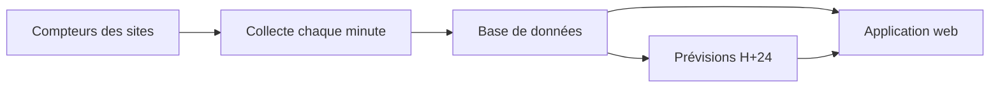

# Documentation fonctionnelle

## Objectif

Smart Energy Optimizer aide un gestionnaire de parc à **suivre, anticiper et réduire** la consommation électrique de ses sites.

L'application répond à trois questions :

- **Que consomme mon parc maintenant ?**
- **Que va-t-il consommer dans les prochaines heures ?**
- **Quels sites posent problème et que faire ?**

## Utilisateurs

| Rôle | Accès |
|---|---|
| Utilisateur | Consulte uniquement les sites rattachés à son compte |
| Administrateur | Idem, plus la gestion des utilisateurs et de leurs rôles |

L'accès se fait par identifiant et mot de passe (écran **Connexion**).

## Fonctionnement général

1. Les mesures de chaque site sont **collectées toutes les minutes**.
2. Les minutes manquantes sont **rattrapées** chaque heure, ou **estimées** si elles restent absentes.
3. Un modèle produit chaque heure une **prévision sur 24 h** par site.
4. L'application affiche mesures, prévisions, alertes et recommandations.

## Écrans

### Parc

Vue d'ensemble de tous les sites.

- **Consommation instantanée** du parc et nombre de sites remontés
- **Charge moyenne** par rapport à la capacité totale
- **Qualité des données** : sites complets, estimés ou sans mesure
- Courbe de consommation des dernières heures
- Liste des alertes actives

Un site sans mesure récente est exclu du total et signalé.

### Site

Détail d'un site choisi dans la liste.

- Fiche : type, localisation, capacité
- **Dernière mesure** : consommation, tension, courant, facteur de puissance, température, humidité
- Courbe de consommation sur 6 h, 24 h, 48 h ou 7 jours, avec un pas réglable
- Distinction entre valeurs **mesurées** et **estimées**
- Synthèse de la période (pic, énergie consommée, couverture des données)
- Alertes du site
- **Recommandations**

### Prévisions

Consommation attendue d'un site sur les **24 prochaines heures**.

- Pic prévu et son heure
- Énergie prévue
- Date de fin de la prévision (nouvelle série chaque heure)
- Modèle utilisé
- Courbe mesurée et prévue sur le même graphique

### Alertes

Liste filtrable de toutes les alertes, mise à jour **toutes les 30 s**.

- Filtres : site, sévérité, type, période (1 h à 7 jours)
- Compteurs par sévérité, cliquables pour filtrer

| Sévérités | Types |
|---|---|
| Faible, Moyenne, Élevée, Critique | Pic, Seuil dépassé, Anomalie, Risque de coupure, Capteur |

## Recommandations

Pour chaque site, l'application évalue trois indicateurs électriques :

| Indicateur | Ce qu'il révèle |
|---|---|
| Facteur de puissance | Énergie réactive gaspillée |
| Tension | Qualité de l'alimentation |
| Taux de charge | Marge par rapport à la capacité du site |

Chaque indicateur reçoit une note (**bon**, **moyen**, **mauvais**) et un conseil court, détaillable avec **Voir plus**.

## Qualité des données

L'application affiche toujours l'état des données plutôt que de masquer un trou :

- **Mesurée** : valeur reçue du site
- **Estimée** : valeur calculée pour combler une minute manquante
- **Sans mesure** : aucune donnée récente, le site est exclu des totaux
