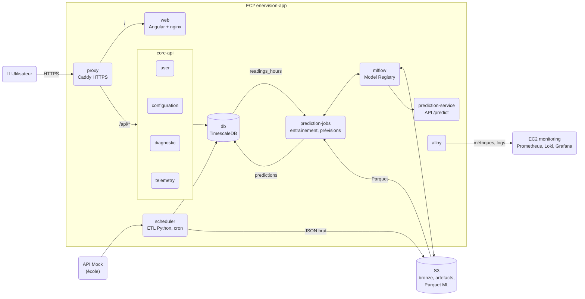

# Architecture applicative

## Composants

| Composant | Rôle | Doc |
|---|---|---|
| `proxy` | Caddy, seul point d'entrée public. HTTPS automatique, `/api/*` vers core-api, le reste vers le front | [Déploiement](infra/deploiement.md) |
| `web` | Front Angular servi par nginx. Ne parle qu'à core-api | UI |
| `core-api` | API REST Spring Boot, monolithe modulaire : comptes et JWT (`user`), sites (`configuration`), alertes et recommandations (`diagnostic`), mesures et prévisions (`telemetry`) | Core API |
| `scheduler` | ETL Python lancé par cron : collecte chaque minute, rattrapage et agrégats chaque heure, sites chaque jour | ETL Worker |
| `db` | PostgreSQL 16 + TimescaleDB. Schéma géré par Liquibase (service `migrate`) | [Modèle de données](modele-de-donnees.md) |
| `prediction-jobs` | Réentraîne le modèle chaque nuit, publie chaque heure une prévision sur 24 h | Prediction Service |
| `prediction-service` | Sert le modèle champion (`/predict`). Interne, jamais exposé | Prediction Service |
| `mlflow` | Suivi des entraînements et registre des modèles (alias `champion`) | ML Service |
| `alloy` | Pousse métriques et logs vers l'EC2 de monitoring | [Monitoring](infra/monitoring.md) |

Le **ML Service** n'est pas un conteneur de production : c'est l'outillage hors ligne (notebooks, campagnes d'essais) qui a permis de choisir le modèle.

## Flux principaux

1. **Collecte** : chaque minute, l'ETL lit `/current` de l'API Mock pour chaque site, archive le JSON brut dans S3 puis l'écrit dans `readings_raws`. Les minutes manquées sont rattrapées chaque heure via `/readings`.
2. **Agrégation** : chaque heure, l'ETL calcule `readings_hours` à partir des mesures brutes.
3. **Prévision** : chaque heure à :05, `prediction-jobs` calcule 24 h de prévisions avec le champion et les écrit dans `predictions`.
4. **Consultation** : le front appelle core-api avec un jeton JWT. core-api lit la base et ne renvoie que les sites visibles par l'utilisateur.

core-api ne dépend ni de l'ETL ni du ML : tout passe par la base. Un service arrêté n'empêche pas les autres de tourner.
