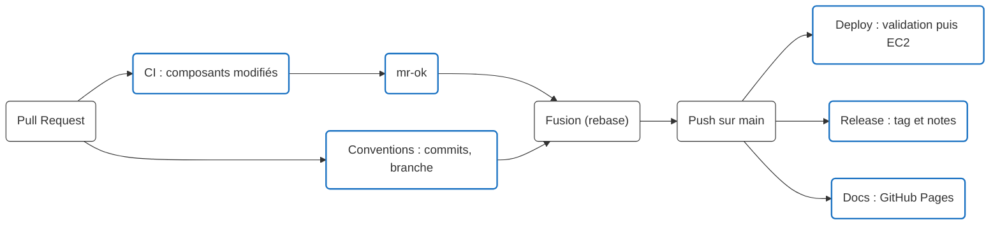

# Intégration continue (CI)

Cette page décrit les vérifications automatiques du dépôt. Le déploiement en production est
décrit dans [Déploiement CI/CD](deploiement.md) et [Comprendre le déploiement](fonctionnement-cd.md).

## Vue d'ensemble des workflows

| Workflow | Fichier | Déclenchement | Rôle |
| :--- | :--- | :--- | :--- |
| **CI** | `ci.yml` | PR, push sur `main`, manuel | Lint, tests, couverture, Sonar et build des images des composants modifiés |
| **Conventions** | `commitlint.yml` | PR vers `main` | Format Conventional Commits des commits et nom de la branche |
| **Deploy** | `services.yml` | Push sur `main`, manuel | Construit, publie et déploie les services modifiés, après validation |
| **Release** | `release.yml` | Push sur `main` | Tag `vX.Y.Z` et notes de version (semantic-release) |
| **Docs** | `docs.yml` | Push sur `main` touchant la documentation | Publie ce site MkDocs sur GitHub Pages |
| **Backup and integrity** | `backup.yml` | Chaque nuit (02:15 UTC), manuel | Sauvegarde immuable et contrôle de restauration, voir [Sauvegardes](../transverse/infra/sauvegardes.md) |

Les mises à jour de dépendances sont proposées par Renovate ([Renovate](renovate.md)) et la
qualité du code est suivie dans SonarCloud ([Sonar](sonar.md)).



## Workflow CI (`ci.yml`)

Conçu pour un monorepo : seuls les composants dont les fichiers ont changé sont vérifiés.

### Déclencheurs

* **Pull Request** : à chaque création ou mise à jour.
* **Push sur `main`** : après la fusion.
* **Manuel** (`workflow_dispatch`) : tous les composants sont alors vérifiés.

!!! info "Gestion de la concurrence"
    Sur une PR, un nouveau push annule l'exécution en cours. Sur `main`, les exécutions vont
    toujours à leur terme.

### 1. Détection des modifications (`changes`)

Le job `changes` confronte les fichiers modifiés à des filtres (`dorny/paths-filter`) :

| Filtre | Fichiers surveillés |
| :--- | :--- |
| `frontend` | `app/**` |
| `core-api` | `services/core-api/**`, `infra/db/changelog/**` (le schéma validé par Hibernate) |
| `etl-worker` | `services/etl-worker/**` |
| `prediction-service` | `services/prediction-service/**`, `services/ml-service/training/**`, `services/ml-service/configs/hgb_production.yaml` |
| `terraform` | `infra/terraform/**`, `.github/services.json` (dépôts ECR), `infra/backup/dump_db.py` et `dump_host.py` (embarqués dans les documents SSM) |
| `infra` | `infra/**`, `scripts/ml/**`, fichiers DVC, `.github/workflows/**`, Dockerfiles, fichiers compose, `sonar-project.properties` |

Chaque filtre inclut aussi le workflow réutilisable correspondant.

Sur les PR uniquement, `scripts/ci/changed-services.py` calcule en plus la liste des **images
Docker** à construire, avec les mêmes règles que le déploiement (`.github/services.json`,
comparaison avec la base de la PR).

### 2. Sous-workflows

Chaque composant a son workflow réutilisable, appelé si son filtre a détecté un changement
(ou lors d'un lancement manuel).

| Composant | Job | Workflow | Vérifications |
| :--- | :--- | :--- | :--- |
| **Frontend** | `call-frontend` | `_ci-frontend.yml` | ESLint, tests Vitest avec couverture, build Angular, Sonar |
| **Core API** | `call-core-api` | `_ci-core-api.yml` | `./mvnw verify` : format, tests (dont Testcontainers), couverture JaCoCo, rapports de test en artefact, Sonar |
| **ETL Worker** | `call-etl-worker` | `_ci-python.yml` | `uv sync --frozen`, `ruff check` et `ruff format --check`, `pytest` avec couverture, `uv build`, Sonar |
| **Prediction Service** | `call-prediction-service` | `_ci-python.yml` | Mêmes étapes que l'ETL Worker |
| **Terraform** | `call-terraform` | `_ci-terraform.yml` | `terraform fmt`, `validate`, TFLint, puis `terraform plan` sur la PR (rôle AWS en lecture `enervision-github-plan`, OIDC) |
| **Infra** | `call-infra` | `_ci-infra.yml` | Tests des releases de datasets ML (sans AWS), lint et tests des scripts de sauvegarde (couverture minimale 85 %), Sonar de la racine, Hadolint (Dockerfiles), actionlint (workflows), DCLint (fichiers compose) |
| **Docker Images** | `call-images` | `_ci-images.yml` | Sur les PR, construit l'image de chaque service modifié **sans la publier**, avec le même cache que le déploiement, puis scan **Trivy** (voir ci-dessous) |
| **Stack** (staging éphémère) | `call-stack` | `_ci-stack.yml` | Démarre la stack `docker compose` sur le runner et la vérifie (voir ci-dessous) |

!!! info "Un seul workflow pour les services Python"
    `_ci-python.yml` prend en entrée le nom et le dossier du service : l'ETL Worker et le
    Prediction Service partagent ainsi exactement les mêmes étapes, avec leurs dépendances
    verrouillées par `uv.lock`.

Secrets utilisés : un jeton Sonar par composant (`SONAR_TOKEN_FRONTEND`, `SONAR_TOKEN_CORE_API`,
`SONAR_TOKEN_ETL_WORKER`, `SONAR_TOKEN_PREDICTION_SERVICE`, `SONAR_TOKEN_INFRA_ROOT`). Le plan
Terraform s'authentifie par OIDC (variable `AWS_PLAN_ROLE_ARN`), sans clé AWS stockée.

### Scan des images (Trivy)

Chaque image construite est scannée par Trivy (`trivy.yaml`) : une vulnérabilité **HIGH ou
CRITICAL corrigeable** fait échouer le job, donc la PR. Les résultats (SARIF) remontent dans
l'onglet *Security* de GitHub. `.trivyignore` reste vide : une faille se corrige (mise à jour
de l'image ou des paquets), elle ne s'ignore pas.

### Staging éphémère : la stack démarrée en CI (`call-stack`)

Les tests unitaires ne voient pas les problèmes d'intégration : migration qui casse le schéma
attendu par core-api, ETL qui démarre mais ne collecte rien, contrat entre front et back. Le job
**Stack** démarre la vraie stack `docker compose` sur le runner et la vérifie avec
`scripts/ci/stack-smoke.sh`.

**Déclenchement** : PR (ou lancement manuel) qui touche `app/`, `services/core-api/`,
`services/etl-worker/`, `infra/db/changelog/`, `compose.yaml`, le script ou le workflow.

**Déroulement** :

1. Construction des images `core-api`, `web` et `etl-worker`, avec le même cache que les builds
   d'images.
2. `.env` de test généré à chaque run : mots de passe aléatoires de la base et des comptes par
   service (`MIGRATOR_`, `CORE_API_`, `ETL_`, `PREDICTION_`, `MONITORING_DB_PASSWORD`),
   `JWT_SECRET`, compte administrateur ; identifiants de l'API Mock depuis les secrets GitHub.
3. `docker compose up` de `db`, `db-bootstrap`, `migrate`, `core-api`, `web` et `scheduler`,
   puis vérifications :

| Vérification | Ce qu'elle détecte |
| :--- | :--- |
| `db-bootstrap` terminé sans erreur, les rôles PostgreSQL par service créés | Script de rôles cassé, mot de passe manquant |
| `migrate` terminé sans erreur, tous les fichiers du changelog appliqués sur une base vierge | Changeset invalide ou manquant |
| core-api répond (`/v3/api-docs`) | Schéma refusé par Hibernate, configuration manquante |
| Le scheduler écrit `Fin sync-readings` et `Fin sync-alerts` en moins de 2 min 30, sans `Échec`, et des mesures arrivent en base | **ETL qui ne collecte pas**, même sans erreur visible (incident du 27/10) |
| Connexion de l'administrateur, 401 sans jeton, `/sites`, `/stats/summary`, dernière mesure d'un site, `/alerts` | Sécurité JWT, routes cassées, contrat de réponse |
| Le front sert l'application Angular | Build ou configuration nginx |

4. Logs de chaque service publiés en artefact `stack-logs` en cas d'échec (7 jours), puis
   `docker compose down -v`.

La collecte utilise la **vraie API Mock de l'école** : si elle est indisponible, le job échoue
sans que le code soit en cause ; relancer le job. **Hors périmètre** : le profil `ml` (MLflow,
`prediction-jobs`) et les problèmes propres à l'EC2 (disque, IAM, SSM).

### 3. Validation finale pour la fusion (`mr-ok`)

Dans un monorepo, les jobs d'un composant non modifié sont *skipped* : on ne peut pas les
rendre obligatoires un par un. Le job `mr-ok` dépend de **tous** les jobs du workflow et
consolide leurs résultats.

!!! success "Critères de réussite"
    * Aucun job n'a échoué ni été annulé.
    * Tous les jobs ont le statut `success` ou `skipped`.

## Conventions (`commitlint.yml`)

Sur chaque PR vers `main`, deux checks :

* **`commits`** : chaque commit de la PR respecte Conventional Commits (règles dans
  `commitlint.config.mjs`, déjà vérifiées en local par le hook `.githooks/commit-msg`) ;
* **`branch-name`** : la branche s'appelle `feature/…`, `fix/…` ou `renovate/…`.

Les PR sont fusionnées en **rebase** : les commits arrivent tels quels sur `main`, et c'est
eux que semantic-release analyse pour calculer la version.

!!! tip "Checks obligatoires"
    Le ruleset « Main protection » de GitHub exige **`commits`**, **`branch-name`** et
    **`mr-ok`** pour autoriser la fusion d'une PR.

## Release (`release.yml`)

À chaque push sur `main`, semantic-release (configuration `.releaserc.json`) lit les commits
depuis la dernière version :

| Type de commit | Version |
| :--- | :--- |
| `fix`, `perf`, `refactor`, `revert` | correctif : `v1.2.3` → `v1.2.4` |
| `feat` | mineure : `v1.2.3` → `v1.3.0` |
| changement cassant (`!` ou `BREAKING CHANGE`) | majeure : `v1.2.3` → `v2.0.0` |
| `docs`, `test`, `build`, `ci`, `chore` | aucune version |

Il crée le tag, la release GitHub avec ses notes classées par section, et commente les PR et
issues incluses.

## Docs (`docs.yml`)

À chaque push sur `main` qui touche `docs/`, `mkdocs.yml` ou la documentation d'un service,
le site est reconstruit (`mkdocs gh-deploy --strict`) et publié sur GitHub Pages. Le mode
`--strict` fait échouer la publication en cas de lien cassé ou d'avertissement.

```bash
uv sync --frozen
uv run mkdocs serve      # aperçu local sur http://127.0.0.1:8000
```
