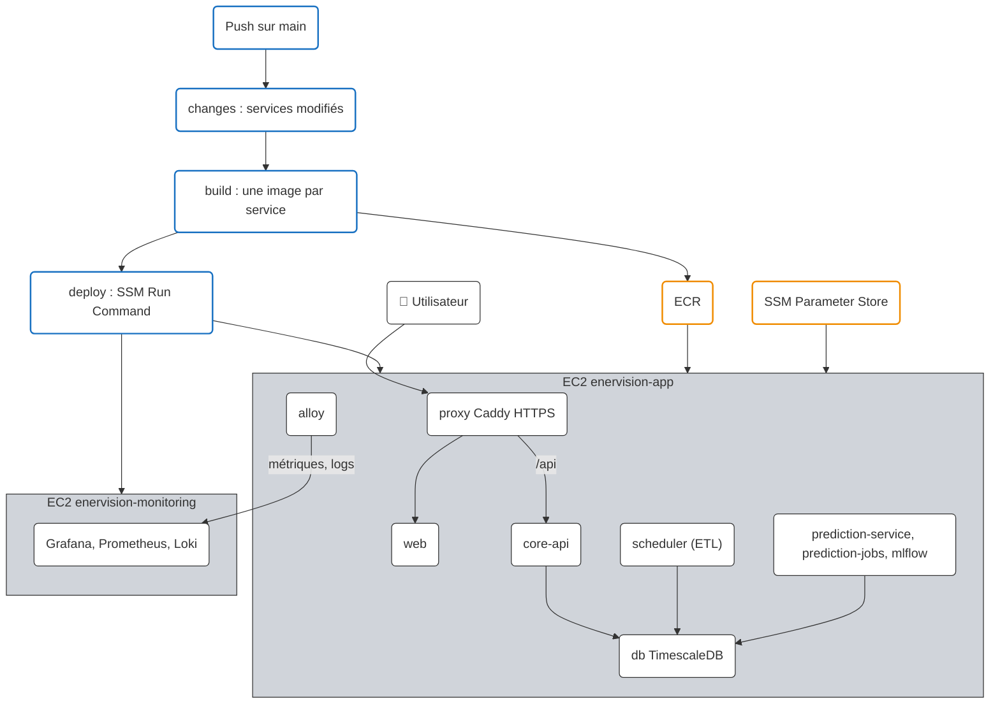

# Déploiement CI/CD

L'application est servie sur **<https://ener-vision.click>** par une EC2 (`enervision-app`,
t3.medium par défaut, eu-west-3) qui exécute `../../../compose.yaml` + `compose.prod.yaml`. Une
seconde EC2 (`enervision-monitoring`, t4g.small) héberge Prometheus, Loki et Grafana
(<https://grafana.ener-vision.click>). Les images sont construites par GitHub Actions, poussées
dans ECR, puis redéployées via SSM Run Command (pas de SSH). Seuls les services modifiés sont
reconstruits et redéployés.

!!! tip "Première fois ?"
    [Comprendre le déploiement](fonctionnement-cd.md) explique pas à pas le fonctionnement
    (build, ECR, SSM) et la sécurité (OIDC, rôles IAM), avec des schémas.



| Événement | Ce qui se passe |
|---|---|
| PR vers `main` | Vérifie les composants modifiés et construit leurs images sans les publier (workflow `ci.yml`, voir [Intégration continue](ci-cd.md)) |
| Push sur `main` | Construit et publie dans ECR, puis redéploie les services modifiés **après validation** |
| Lancement manuel | Déploie les services choisis, **après validation** : `gh workflow run Deploy -f services=web,db` |

!!! warning "Validation manuelle du déploiement"
    Le job `Production` utilise l'environment GitHub **`production`** : il attend qu'un membre
    de l'équipe `smart-energy-optimizer-team` clique sur **Review deployments → Approve and
    deploy** dans le run du workflow `Deploy`. Les images sont déjà publiées dans ECR : seule la
    mise à jour de l'EC2 attend. Si plusieurs merges arrivent avant la validation, seul le
    dernier reste en attente ; il déploie aussi les changements des précédents (comparaison
    avec le dernier commit déployé).

    Configuration (*Settings → Environments → production*) :

    - **Required reviewers** : l'équipe `smart-energy-optimizer-team` ;
    - **Deployment branches and tags** : *Selected branches*, règle `main` uniquement.

## Composants

| Élément | Emplacement |
|---|---|
| Liste des services | `../../../.github/services.json` |
| Sélection des services modifiés | `../../../scripts/ci/changed-services.py` |
| Workflow | `../../../.github/workflows/services.yml` |
| Surcharge production de compose | `../../../compose.prod.yaml` |
| Reverse proxy HTTPS | `../../../infra/proxy/Caddyfile` |
| Script exécuté sur l'EC2 | `../../../infra/deploy/deploy.sh` |
| Release des datasets ML | `../../../infra/deploy/dataset_release.py`, `../../../scripts/ml/upload-bootstrap.sh` |
| Script exécuté sur l'EC2 de monitoring | `../../../infra/monitoring/deploy.sh` |
| Infrastructure | `../../../infra/terraform` (state dans le bucket S3 `enervision-tfstate-s3`) |

Ressources AWS créées par Terraform :

- **EC2** Amazon Linux 2023 avec Docker + Compose, IP élastique, ports 80 et 443 ouverts ;
- **DNS** : `ener-vision.click` et `www.ener-vision.click` (zone Route 53 existante) vers l'IP élastique ;
- **volume EBS séparé** monté sur `/var/lib/docker` : les données TimescaleDB survivent à un
  remplacement de l'instance (`prevent_destroy`) ;
- **un dépôt ECR par service** ayant un `build` dans `services.json` (20 dernières images
  gardées, analyse des vulnérabilités à chaque push) ;
- **bucket S3** `enervision-deploy-<compte>` : fichiers compose et `../../../infra` de chaque release ;
- **bucket S3** `enervision-datalake-<compte>` : données brutes (bronze) de l'ETL et datasets ML ;
- **bucket S3** `enervision-backup-<compte>` : sauvegardes immuables (Object Lock, 7 jours),
  voir [Sauvegardes](../transverse/infra/sauvegardes.md) ;
- **EC2 de monitoring** `enervision-monitoring` avec son IP élastique et `grafana.ener-vision.click`
  (voir [Monitoring](monitoring.md)) ;
- **paramètres SSM** `/enervision/prod/env/<NOM>` : le `.env` de production, relu à chaque
  déploiement (mot de passe de la base généré par Terraform) ;
- **rôle IAM GitHub (OIDC)** : aucune clé AWS dans GitHub, déploiement depuis `main` uniquement.

!!! info "RDS non utilisé"
    TimescaleDB n'est pas disponible sur RDS / Aurora : la base tourne dans un conteneur
    sur l'EC2, avec ses données sur le volume EBS dédié.

## HTTPS et nom de domaine

Le service `proxy` (Caddy, uniquement en production) est le seul exposé sur Internet :

- il obtient et renouvelle automatiquement les certificats Let's Encrypt de `ener-vision.click`
  et `www.ener-vision.click` (stockés dans le volume `caddydata`) ;
- il redirige HTTP vers HTTPS et `www` vers le domaine principal ;
- il transmet `/api/*` à `core-api` et le reste au service `web` ; aucun des deux n'est publié
  sur l'hôte ;
- il écrit ses logs d'accès en JSON et expose ses métriques sur le port interne `9180`, lus par
  Alloy pour le [Monitoring](monitoring.md).

Pour exposer un nouveau service, ajouter une route dans `../../../infra/proxy/Caddyfile`, avant
le `handle` final vers `web` :

```
handle /mon-service/* {
	reverse_proxy mon-service:8080
}
```

## Première installation

Prérequis : outils installés (`../../../scripts/aws/install-tools.sh`) et session SSO active
(voir [Init AWS user](init-aws.md)).

```bash
cd infra/terraform
cp backend.hcl.example backend.hcl
cp terraform.tfvars.example terraform.tfvars   # renseigner energy_api_base_url
terraform init -backend-config=backend.hcl
terraform plan
terraform apply
terraform output -raw github_variables | bash   # variables du dépôt pour le workflow
```

Le premier push sur `main` qui contient le workflow déploie alors tous les services
(aucun commit déployé auparavant). Ensuite :

- URL de l'application : `terraform output url` ;
- shell sur l'instance : `aws ssm start-session --target $(terraform output -raw instance_id)`.

!!! warning "`gh workflow run`"
    Le lancement manuel n'est possible qu'une fois `services.yml` présent sur `main`.

## Déploiement par service

Chaque service de `../../../.github/services.json` déclare :

- `paths` : préfixes de fichiers qui le déclenchent ;
- `build` (optionnel) : contexte et Dockerfile de son image. Sans `build` (`proxy`, `db` :
  images publiques), le service est seulement redémarré avec sa nouvelle configuration.

```json
{
  "services": {
    "web": {
      "paths": ["app/web/"],
      "build": { "context": "app/web", "dockerfile": "app/web/Dockerfile" }
    }
  }
}
```

Un fichier listé dans `global` (compose, scripts de déploiement, workflow…) redéploie tous
les services.

Les changements sont comparés au **dernier commit déployé avec succès** (paramètre SSM
`/enervision/prod/deployed-sha`), et non au commit précédent : un déploiement en échec ou
annulé est rattrapé au push suivant. Supprimer ce paramètre force un redéploiement complet.

Sur l'EC2, `deploy.sh` met à jour le tag des seuls services concernés dans
`/opt/enervision/deploy.env`, puis lance `docker compose pull` et `up -d` sur ces services :
les autres conteneurs ne sont pas touchés.

## Ajouter un service

1. Le déclarer dans `../../../compose.yaml`, puis dans `compose.prod.yaml` :

    ```yaml
    mon-service:
      build: !reset null
      image: ${ECR_REGISTRY}/enervision/mon-service:${MON_SERVICE_TAG:-latest}
      restart: unless-stopped
    ```

2. L'ajouter dans `../../../.github/services.json` (`paths` et `build`).
3. `terraform apply` : crée son dépôt ECR et le droit de push associé.
4. Ses variables d'environnement : dans `app_env` (`variables.tf`) ou un paramètre SSM
   `/enervision/prod/env/<NOM>` (type `SecureString` pour un secret).
5. S'il doit être accessible depuis Internet : une route dans `../../../infra/proxy/Caddyfile`.

## Limites actuelles

- **Une seule EC2 applicative** : pas de haute disponibilité, un redémarrage de l'instance
  interrompt le service.
- **Pas de staging permanent** : la CI démarre une stack éphémère (sans le profil `ml`) pour
  chaque PR concernée ; la stack complète, ML compris, n'est démarrée qu'en production.
- **Validation manuelle** de chaque déploiement : rien ne part en production sans un membre de
  l'équipe.
- Coût estimé : environ 60 $/mois, hors trafic et requêtes S3 (EC2 t3.medium ~34 $,
  EC2 de monitoring t4g.small ~14 $, environ 70 Go d'EBS ~7 $, deux IP publiques ~7 $,
  zone Route 53 0,50 $).
