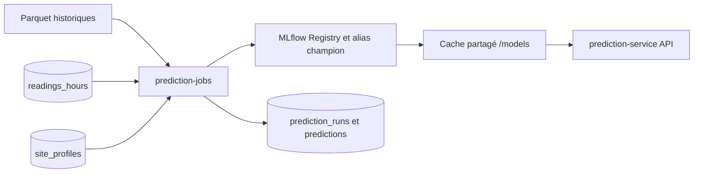

# Fonctionnement du Prediction Service

`prediction-service` prévoit la consommation électrique horaire en kWh. Deux conteneurs utilisent la même image : `prediction-service` sert l'API et garde le modèle champion en mémoire ; `prediction-jobs` entraîne les challengers et produit les prévisions nocturnes. Ils partagent le volume `/models`. Les horaires ci-dessous utilisent `Europe/Paris` ; les heures prédites sont enregistrées comme instants UTC en base.



## Déclenchement des jobs

| Moment | Action |
| --- | --- |
| Chaque jour à **01:00** | Démarre un entraînement HGB. Le calcul s'exécute dans un thread distinct : il ne bloque pas la génération des prévisions. |
| Au démarrage, puis au plus une tentative par heure | Si aucun entraînement réussi n'existe dans MLflow ou si le dernier date de **plus de 25 heures**, lance un entraînement de rattrapage. |
| Chaque heure à **:05**, puis à `:20`, `:35` et `:50` en cas d'échec | Complète la fenêtre des 24 heures suivantes, une fois par heure UTC : en temps normal, seule la nouvelle heure H+24 est prévue. |

Le conteneur `prediction-jobs` doit rester démarré pour exécuter ces tâches. La table `prediction_jobs` conserve l'état des tentatives. Un verrou PostgreSQL empêche deux exécutions simultanées d'un même type de job ; la clé de l'heure UTC (`2026-10-26T14:00Z`) évite de republier un lot déjà réussi. Une tentative échouée peut être reprise. Les changements d'heure sont traités à partir des instants UTC : la fenêtre contient toujours 24 heures successives.

## Entraînement quotidien

1. Le job lit les trois fichiers historiques `train.parquet`, `validation.parquet` et `test.parquet` depuis `TRAINING_BOOTSTRAP_URI` : `/bootstrap` en local ou un préfixe S3 en production. Le script `../../../scripts/ml/upload-bootstrap.sh` sert au transfert initial vers S3.
2. Il conserve les splits d'origine : Train du 2023-01-01 au 2024-07-01 exclu, Validation du 2024-07-01 au 2024-10-01 exclu, Test du 2024-10-01 au 2025-01-01 exclu. Les trois jeux doivent être chronologiques et couvrir les mêmes sites.
3. Le modèle apprend uniquement sur `train.parquet`. Il est évalué séparément sur `validation.parquet`, puis sur `test.parquet` pour le test final. Aucune donnée SQL récente n'est utilisée pour entraîner ou évaluer les modèles pour l'instant. `validation.parquet` et `test.parquet` ne rejoignent pas le Train.
4. Il entraîne un seul challenger `HistGradientBoostingRegressor` avec `max_leaf_nodes=31` et les features `site_id`, `hour`, `day_of_week`, `month` et `is_working_hours`. **Ni température ni lags** ne sont utilisés par ce modèle de production.
5. Il enregistre dans MLflow la configuration, la provenance des données, les métriques et le modèle, puis vérifie qu'il peut recharger celui-ci. Chaque challenger obtient une version dans le Model Registry.

La métrique de sélection est `test_macro_nmae_pct`, moyenne des NMAE calculées séparément pour chaque site sur le Test historique. La validation reste disponible sous `val_macro_nmae_pct` :

```text
NMAE_site (%) = 100 × moyenne(|réel − prédit|) / moyenne(|réel|)
test_macro_nmae_pct = moyenne(NMAE_site sur test.parquet)
```

Le challenger et le champion sont évalués sur **les mêmes lignes de `test.parquet`**. Sans champion, le premier candidat valide est promu. Sinon, le challenger remplace le champion uniquement si son score est au moins **4 % meilleur relativement** : `score_challenger <= 0,96 × score_champion`, avec un score champion positif. Par exemple, un score champion de 5,00 % demande au plus 4,80 %. Si la NMAE d'un site est indéfinie, la promotion est refusée. MLflow conserve les métriques Train, Validation et Test, ainsi que le score `champion_test_macro_nmae_pct` pour cette comparaison.

La promotion met à jour l'alias MLflow `champion` et le cache versionné dans `/models/versions/`. Un entraînement réussi peut donc se terminer **sans promotion**. Tant qu'il reste un champion, l'API continue de servir celui qu'elle a déjà chargé pendant le calcul et en cas d'échec du challenger.

## Prévisions horaires

Avant le calcul, le job vérifie qu'un agrégat `readings_hours` suffisamment récent existe. Il charge le champion disponible, puis lit `site_profiles`. Un site doit avoir un profil et être connu du modèle ; les sites avec profil mais inconnus du modèle sont signalés puis ignorés. Si aucun site n'est éligible, le lot échoue.

À 14:05, par exemple, la fenêtre va de **15:00** à 14:00 le lendemain (24 heures réelles successives). L'heure en cours reste couverte par une série précédente.

### Heures manquantes seulement

Le modèle n'utilise que le calendrier : prévoir à nouveau une heure déjà prévue redonnerait la même valeur brute, seul le ratio de recalage bougerait de quelques millièmes. Chaque série ne calcule donc que les **heures manquantes** de la fenêtre : celles dont la prévision affichée (dernier lot complet, comme `core-api`) n'existe pas ou ne vient pas du champion courant, pour au moins un site.

| Situation | Heures calculées |
| --- | --- |
| Temps normal | 1 : la nouvelle heure H+24 (les 23 autres ont été prévues par les séries précédentes) |
| Série précédente en échec | Les heures restées sans prévision : le trou se comble seul |
| Démarrage, base vide | Les 24 |
| Nouveau champion (version différente) | Les 24, pour ne pas afficher un mélange de deux modèles |
| Fenêtre déjà complète | Aucune : rien n'est publié (`Prévisions déjà à jour` dans les logs) |

Conséquence : une heure garde le ratio du moment où elle a été prévue, en général 24 h avant. Les ratios variant de quelques millièmes d'une heure à l'autre, l'écart est négligeable ; un changement de la règle de recalage demande en revanche de recalculer la fenêtre (pas encore de commande dédiée).

Pour chaque site et chaque heure à calculer, le job construit les cinq variables du modèle selon l'heure UTC (les heures de travail du CSV d'entraînement et de l'API Mock ne suivent pas l'heure d'été), vérifie que la valeur prédite est finie et positive ou nulle, lui applique le [recalage de niveau](#recalage-de-niveau) du site, puis écrit le lot entier dans une transaction PostgreSQL.

| Table | Contenu |
| --- | --- |
| `prediction_jobs` | Déclenchement, statut et éventuelle erreur des jobs. |
| `prediction_runs` | Version du modèle, heures couvertes par le lot (`window_start` = première, `window_end` = dernière + 1 h), date de génération et taille du lot. |
| `predictions` | `run_id`, `site_id`, `predicted_for` et, pour chaque heure : `prediction_kwh` (valeur publiée, lue par `core-api`), `model_prediction_kwh` (prévision brute du champion) et `level_ratio` (ratio appliqué). Les deux dernières colonnes sont NULL pour les lots antérieurs au changeset 008. |

## Recalage de niveau

### Pourquoi

Le champion a appris sur le CSV historique la **forme** de la consommation : heures de montée et de descente, semaine et week-end. Mais l'API Mock produit des niveaux plus bas : environ **0,66 à 0,83 fois** ceux du CSV selon le site, avec un ratio stable d'un jour à l'autre (±1 à 3 %). Sans correction, les prévisions publiées étaient trop hautes d'environ **29 %** (nMAE macro d'environ 34 %).

Les variables du modèle sont purement calendaires : elles ne peuvent pas dériver. C'est la relation entre ces variables et la consommation qui a changé d'échelle (dérive de concept). Ajouter des lags au modèle entraîné sur le CSV ne corrige pas ce niveau (backtest : 28 à 31 % de nMAE), car l'arbre apprend des seuils en kWh absolus.

### Principe : appliquer un ratio par site

À chaque série (chaque heure à :05), pour chaque site :

```text
ratio = Σ consommation mesurée sur les 7 derniers jours
      / Σ prévision du champion pour ces mêmes heures

prévision publiée = prévision du champion × ratio
```

- **La prévision du champion sur le passé est recalculée** avec le champion courant, et non relue en base : un changement de champion ou d'horaires est pris en compte immédiatement.
- **Deux ratios par site** : un pour les heures travaillées, un pour les autres (selon `site_profiles`), l'écart n'étant pas le même le jour et la nuit (par exemple 0,84 et 0,76 pour l'usine SITE002).
- **Somme puis division**, et non moyenne de ratios horaires : une heure de nuit à faible consommation ne pèse pas plus qu'une heure de pointe.
- **Heures retenues** : heures closes de `readings_hours`, consommation non NULL, calculée sur au moins **10 minutes**. Avec `/current`, l'API Mock ne renvoie la consommation que sur 18 à 32 minutes par heure environ ; leur moyenne suffit à estimer le niveau.

Exemple pour SITE001 à 10:00 UTC un jour ouvré : le champion prévoit 217 kWh, le ratio des heures travaillées vaut 0,789, la prévision publiée est **171 kWh** (mesure habituelle : environ 170 kWh).

### Garde-fous

| Cas | Règle |
| --- | --- |
| Moins de **24 heures** mesurées sur 7 jours (démarrage, longue panne) | Ratio 1 : prévision du champion inchangée. |
| Moins de **12 heures** dans un groupe, ou groupe absent (data center et hôpital toujours actifs) | Le groupe reprend le ratio global du site. |
| Ratio hors de **[0,5 ; 1,5]** (panne de collecte, changement d'unité) | Ratio ramené à la borne, avertissement `Ratio de SITE… ramené dans les bornes` dans les logs. |
| Désactivation | `LEVEL_RECALIBRATION=false` : la prévision brute du champion est publiée (ratio 1 enregistré). |

Le job écrit dans ses logs, pour chaque site et chaque série, une ligne du type `Recalage SITE001 : 0.765 (heures travaillées 0.789, autres 0.733, 168 h mesurées)`.

### Suivi en production

Après chaque série publiée, `prediction-jobs` compare, sur les **24 dernières heures closes**, la dernière prévision publiée avant chaque heure à la mesure (`monitoring.py`), et écrit une ligne par site :

```text
Suivi modèle SITE001 : nMAE champion 33.1 %, publiée 5.2 %, biais publié +0.4 % (24 h)
```

- **nMAE champion** : erreur de `model_prediction_kwh`, le modèle seul (la valeur publiée pour les séries antérieures au recalage) ; elle révèle la dérive de concept que le recalage masque.
- **nMAE publiée** et **biais publié** : erreur de `prediction_kwh`, la valeur affichée.

Mêmes règles que le recalage : heures mesurées sur au moins 10 minutes, même définition de la nMAE que l'entraînement. Le calcul a lieu après la publication, hors du job : s'il échoue (`Suivi du modèle impossible` dans les logs), la série reste publiée. Grafana affiche ces lignes et les ratios dans la ligne « Modèle (prévisions) » du dashboard (voir [Monitoring](monitoring.md)).

### Résultats

Backtest sur les heures mesurées en production du 21 au 27/10 : à chaque heure, prévision des 24 heures suivantes avec les seules mesures antérieures, ratio calculé par la fonction de production (`recalibration.level_ratios`). Détail, tableaux et graphiques dans le notebook `../../../services/ml-service/notebook/02_recalage_niveau_prod.ipynb`.

| Variante | nMAE macro | Biais |
| --- | --- | --- |
| Champion seul (avant) | 34,1 % | +28,6 % |
| Champion × ratio global du site | 8,1 % | +0,4 % |
| **Champion × ratio heures travaillées / autres (production)** | **7,5 %** | **+0,2 %** |
| Référence sans modèle : même heure des jours passés du même type | 1,3 % | +0,1 % |

La référence « profil récent » est très bonne parce que l'API Mock est presque périodique ; elle ne serait pas transposable à de vraies données (météo, jours fériés, tendances). Elle sert de **seuil à battre** pour les futurs challengers, pas de prévision publiée.

### Limites

- **Centre commercial (SITE004) : environ 25 % de nMAE.** Son surplus du week-end, présent dans le CSV, n'existe pas dans l'API Mock (ratio 0,96 le week-end, 0,71 en semaine), et ses nuits de week-end tirent vers le haut le ratio des heures non travaillées (1,02, contre 0,70 pour les heures travaillées).
- **Dérive suivie avec retard** : un changement brutal de niveau n'est complètement absorbé qu'après quelques jours de fenêtre.
- **La dérive devient invisible dans l'erreur publiée.** Il faut suivre séparément l'erreur de `model_prediction_kwh` (champion seul) et `level_ratio` : un ratio durablement loin de 1 signale qu'un réentraînement sur les données récentes est nécessaire (voir [Données, suivi quotidien et nouveaux champions](prediction-service-pratics.md)).
- Le recalage **ne remplace pas un réentraînement** : il corrige l'échelle, pas les écarts ponctuels (pic inhabituel, panne).

Les versions successives des prévisions restent en base. Si le contrôle de fraîcheur, le chargement du champion ou une valeur échoue, aucun lot partiel n'est publié. Si la tentative de :05 échoue, celle de :20, :35 ou :50 calcule les heures manquantes à ce moment ; si toutes échouent, la série de l'heure suivante comble le trou. En temps normal, une série de 7 lignes (une heure × 7 sites) est publiée chaque heure : environ 170 lignes par jour, contre 4 000 quand les 24 heures étaient recalculées.

## API et chargement du champion

L'API privée expose `GET /health` et `POST /predict`. Au démarrage, elle cherche l'alias `champion` dans MLflow, vérifie et charge sa version. Elle revérifie l'alias toutes les **60 secondes** par défaut et change de modèle sans redémarrer. Si MLflow est indisponible, elle peut charger le dernier modèle en cache. Sans modèle disponible, `/health` annonce `degraded` et `/predict` répond `503`.

`POST /predict` accepte `site_id`, `hour`, `day_of_week` (lundi = 0), `month` et `is_working_hours`. Les deux champs de lag restent optionnels pour la compatibilité avec d'anciens modèles ; le HGB de production les ignore. `temperature_celsius` est refusé. La réponse contient la valeur prédite et la version du modèle chargé.

## Configuration et démarrage local

Les paramètres principaux sont `DATABASE_URL`, `MLFLOW_TRACKING_URI`, `REGISTERED_MODEL_NAME`, `TRAINING_BOOTSTRAP_URI`, `TRAINING_TIMEZONE`, `VALIDATION_DAYS`, `MIN_CURRENT_VALIDATION_HOURS`, `MODEL_DIR`, `MODEL_REFRESH_SECONDS` et `LEVEL_RECALIBRATION`. Leurs valeurs et usages détaillés figurent dans la section **Prediction Service** de cette documentation.

```bash
docker compose --profile ml up -d db migrate mlflow prediction-service prediction-jobs
curl http://127.0.0.1:8000/health
```

La génération de prévisions nécessite des agrégats récents dans `readings_hours` et des profils dans `site_profiles`. La lecture des prévisions par `core-api` et leur affichage dans Angular ne sont pas encore implémentés.
