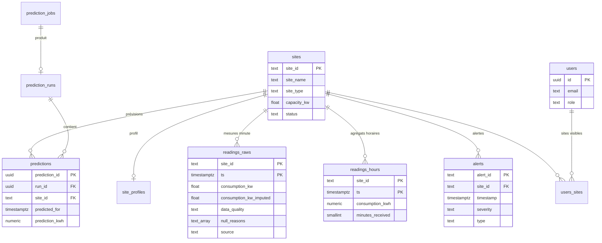

# Modèle de données

Une seule base PostgreSQL 16 + TimescaleDB (`db`). Le schéma est géré uniquement par **Liquibase** (`infra/db/changelog/`), appliqué par le service `migrate` avant le démarrage des autres. Hibernate (core-api) se contente de le valider.

MLflow utilise sa propre base (`mlflow`) dans le même serveur PostgreSQL ; elle n'est pas décrite ici.

## Schéma

Le schéma ne montre que les colonnes principales.

## Tables

| Table | Écrite par | Lue par | Contenu |
|---|---|---|---|
| `sites` | ETL (`sync-sites`) | tous | Référentiel des sites de l'API Mock : nom, type, localisation, capacité |
| `site_profiles` | ETL (`sync-site-profiles`) | core-api, prediction-jobs | Profil de consommation : base, pic, heures et jours ouvrés |
| `readings_raws` | ETL | core-api | **Une ligne par site et par minute**, valeurs brutes NULL compris, qualité, origine (`source`) et consommation imputée. Hypertable TimescaleDB (blocs de 7 jours) |
| `readings_hours` | ETL (`sync-hours`) | core-api (recommandations), prediction-jobs | Moyennes horaires calculées sur les seules valeurs brutes, avec la complétude de l'heure |
| `alerts` | ETL (`sync-alerts`) | core-api | Alertes reçues de l'API Mock, jamais modifiées |
| `prediction_jobs` | prediction-jobs | prediction-jobs | Suivi des exécutions (entraînement, prévision) ; `UNIQUE (job_type, schedule_key)` évite deux lancements du même créneau |
| `prediction_runs` | prediction-jobs | core-api | Un lot de prévisions publié : modèle, version, fenêtre. Seuls les lots `complete` sont lus |
| `predictions` | prediction-jobs | core-api | Une prévision par site et par heure, avec la valeur brute du modèle et le ratio de recalage |
| `users` | core-api | core-api | Comptes : email, mot de passe BCrypt, rôle `USER` ou `ADMIN` |
| `users_sites` | à la main (voir [Gestion des comptes](gestion-des-comptes.md)) | core-api | Sites visibles par un `USER` |

## Règles communes

- **Toutes les dates sont en UTC** (`TIMESTAMPTZ`).
- **Chaque table a un seul écrivain.** core-api est en lecture seule, sauf sur `users`.
- **Les écritures de l'ETL sont rejouables** : `ON CONFLICT DO NOTHING` sur les mesures et les alertes, mise à jour sur les sites et les profils. Relancer une tâche ne crée pas de doublon.
- **Une valeur brute n'est jamais écrasée** : une consommation imputée va dans `consumption_kw_imputed`, avec sa méthode dans `imputation_method`.

## Changesets

| N° | Contenu |
|---|---|
| 001 | Renomme l'ancienne table `readings` en `readings_raws` |
| 002 | Schéma initial : `users`, `sites`, `readings_raws` (hypertable), `alerts`, `readings_hours` |
| 003 | Mise à niveau des bases créées avant 002 |
| 004 | `site_profiles` et `users_sites` |
| 005 | Origine des mesures (`source`), imputation, complétude des heures |
| 006 | `prediction_jobs`, `prediction_runs`, `predictions` |
| 007 | Rôle `monitoring` en lecture des statistiques seulement, pour l'exporteur Postgres d'Alloy |
| 008 | Valeur brute du modèle et ratio de recalage dans `predictions` |

Un changement de schéma passe toujours par un **nouveau** changeset : un changeset déjà appliqué n'est jamais modifié.
