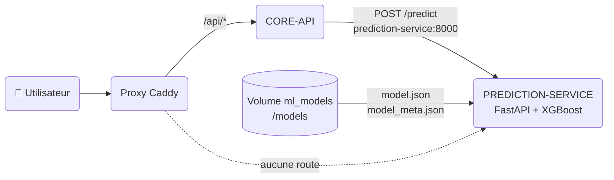
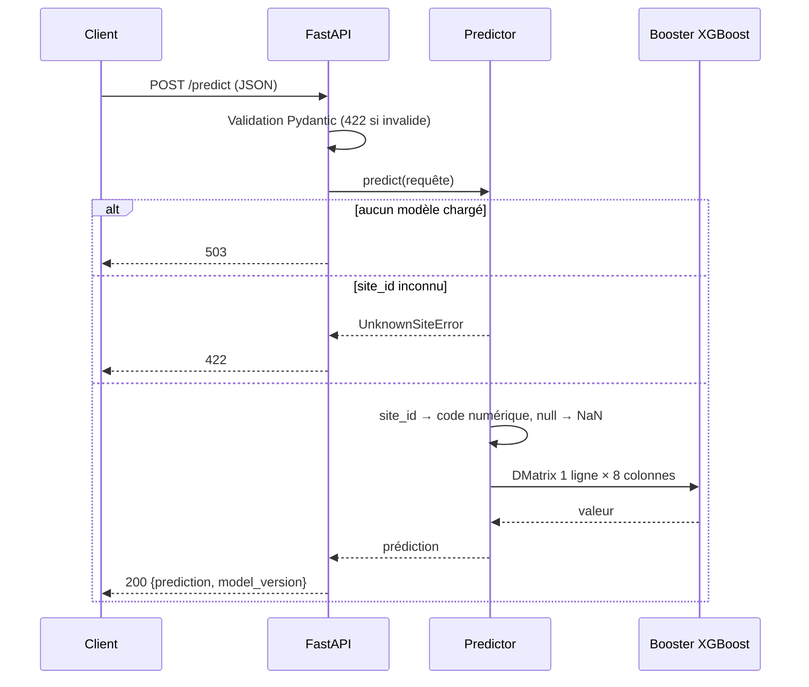

# Prediction Service

`prediction-service` est le service qui héberge le modèle prédictif de consommation (XGBoost) et l'expose en HTTP.
Dans l'état actuel, il fait **une seule chose** : charger un modèle déjà entraîné et répondre à des
demandes de prédiction. L'entraînement, le réentraînement et la comparaison avec des modèles challengers
(via MLflow) ne sont pas encore implémentés.

## Rôle et périmètre

| Fait aujourd'hui | Pas encore fait |
| --- | --- |
| Charge `model.json` + `model_meta.json` au démarrage | Entraînement et réentraînement |
| Expose `POST /predict` et `GET /health` | Comparaison champion / challenger |
| Valide strictement les entrées | Lecture du modèle depuis le registry MLflow |
| Reste privé (jamais derrière le proxy public) | Prédiction par lot |

Le code est dans `services/prediction-service/`, l'image Docker est publiée dans ECR sous `enervision/prediction-service`.

## Place dans l'architecture



!!! info "Service privé"
    Le port `8000` n'est publié que sur `127.0.0.1` de l'hôte. Il n'existe aucune route vers `prediction-service`
    dans le Caddyfile. Il est joignable par les autres conteneurs (`http://prediction-service:8000`) et, sur l'EC2,
    par un tunnel SSM. Il n'y a pas d'authentification : la protection repose sur ce cloisonnement réseau.

## Endpoints

| Méthode | Chemin | Rôle |
| --- | --- | --- |
| `POST` | `/predict` | Prédit la consommation à partir d'une ligne de features |
| `GET` | `/health` | État du service et version du modèle chargé |
| `GET` | `/docs` | Swagger UI (désactivé en production) |

### `POST /predict`

#### Schéma d'entrée

| Champ | Type | Obligatoire | Contrainte | Rôle |
| --- | --- | --- | --- | --- |
| `site_id` | texte | oui | `SITE_` + au moins 3 chiffres (`SITE_001`), connu du modèle | Distinguer les profils des sites |
| `hour` | entier | oui | 0 à 23 | Rythme dans la journée |
| `day_of_week` | entier | oui | 0 à 6, lundi = 0 | Rythme hebdomadaire |
| `month` | entier | oui | 1 à 12 | Variations saisonnières |
| `lag_24h` | décimal | non | ≥ 0 | Consommation du même site à la même heure la veille |
| `lag_168h` | décimal | non | ≥ 0 | Consommation du même site à la même heure 7 jours avant |
| `temperature_celsius` | décimal | non | −60 à 60 | Température à l'heure de prévision |
| `is_working_hours` | entier | oui | 0 ou 1 | 1 = heure de travail, 0 sinon |

- Tout champ non listé est refusé (`extra="forbid"`).
- Les trois champs optionnels peuvent être omis ou valoir `null` : ils sont transmis à XGBoost comme
  **valeurs manquantes** (`NaN`). Le modèle doit avoir vu des valeurs manquantes à l'entraînement pour
  que les prédictions restent fiables dans ce cas.

```json
{
  "site_id": "SITE_001",
  "hour": 14,
  "day_of_week": 2,
  "month": 10,
  "lag_24h": 12.5,
  "lag_168h": 11.0,
  "temperature_celsius": 18.2,
  "is_working_hours": 1
}
```

#### Schéma de sortie (`200`)

| Champ | Type | Description |
| --- | --- | --- |
| `prediction` | décimal | Consommation prévue, dans l'unité de la cible utilisée à l'entraînement |
| `model_version` | texte | Version du modèle chargé (`version` de `model_meta.json`) |

```json
{ "prediction": 12.3, "model_version": "2026-10-23" }
```

#### Codes de retour

| Code | Cas |
| --- | --- |
| `200` | Prédiction calculée |
| `422` | Champ manquant, hors plage, de mauvais type, inconnu, ou `site_id` absent du modèle |
| `503` | Aucun modèle chargé |

### `GET /health`

| Champ | Type | Description |
| --- | --- | --- |
| `status` | texte | `ok` si un modèle est chargé, `degraded` sinon |
| `model_loaded` | booléen | Un modèle est disponible |
| `model_version` | texte ou `null` | Version du modèle chargé |

Le code HTTP est toujours `200` tant que le processus répond : c'est ce qu'utilise le healthcheck Docker
(liveness). L'absence de modèle se lit dans le corps de la réponse.

## Fonctionnement d'une prédiction



Ordre des colonnes transmises au modèle (fixe, identique à l'entraînement) :

`site_id`, `hour`, `day_of_week`, `month`, `lag_24h`, `lag_168h`, `temperature_celsius`, `is_working_hours`

Le `site_id` textuel est converti en entier : sa valeur est sa **position dans la liste `site_ids`**
de `model_meta.json`.

## Artefacts du modèle

Le répertoire `MODEL_DIR` (`/models`, volume Docker `ml_models`) doit contenir deux fichiers.

| Fichier | Contenu |
| --- | --- |
| `model.json` | Booster XGBoost sauvegardé avec `Booster.save_model`, colonnes dans l'ordre ci-dessus |
| `model_meta.json` | Version du modèle et liste ordonnée des sites |

```json
{ "version": "2026-10-23", "site_ids": ["SITE_001", "SITE_002", "SITE_003"] }
```

!!! warning "Cohérence avec l'entraînement"
    La position d'un site dans `site_ids` doit être exactement la valeur numérique de `site_id` utilisée
    pendant l'entraînement. Un décalage donne des prédictions fausses **sans erreur**.

Le modèle est lu **une seule fois au démarrage**. Après avoir remplacé les fichiers, il faut redémarrer
le conteneur. Sans les fichiers, le service démarre en mode `degraded` (`/predict` répond `503`).
Tant que MLflow est désactivé en production, le modèle se dépose à la main dans le volume.

## Configuration

| Variable | Défaut | Rôle |
| --- | --- | --- |
| `MODEL_DIR` | `/models` | Répertoire des artefacts du modèle |
| `LOG_LEVEL` | `INFO` | Niveau de logs |
| `ENABLE_DOCS` | `true` | Active `/docs` et `/openapi.json` (`false` en production) |

## Déploiement

- **Local** : `docker compose up prediction-service` puis `http://127.0.0.1:8000`.
- **Production** : déployé comme les autres services par le workflow *Deploy* (image ECR, SSM).
  Limite mémoire de 512 Mo, Swagger désactivé, aucune route publique.
- **CI** : lint (`ruff check`, `ruff format --check`), tests `pytest` avec couverture, build du paquet
  et analyse Sonar (workflow `_ci-prediction-service.yml`).

## Tester à la main

Depuis l'EC2 (session SSM) ou en local :

```bash
curl -s http://127.0.0.1:8000/health

curl -s http://127.0.0.1:8000/predict \
  -H 'Content-Type: application/json' \
  -d '{"site_id":"SITE_001","hour":14,"day_of_week":2,"month":10,
       "lag_24h":12.5,"lag_168h":11.0,"temperature_celsius":18.2,"is_working_hours":1}'
```

## Évolutions prévues

- Entraînement et réentraînement planifiés.
- Comparaison du champion avec des challengers et suivi des runs dans MLflow.
- Chargement du modèle depuis le registry MLflow à la place du volume.
