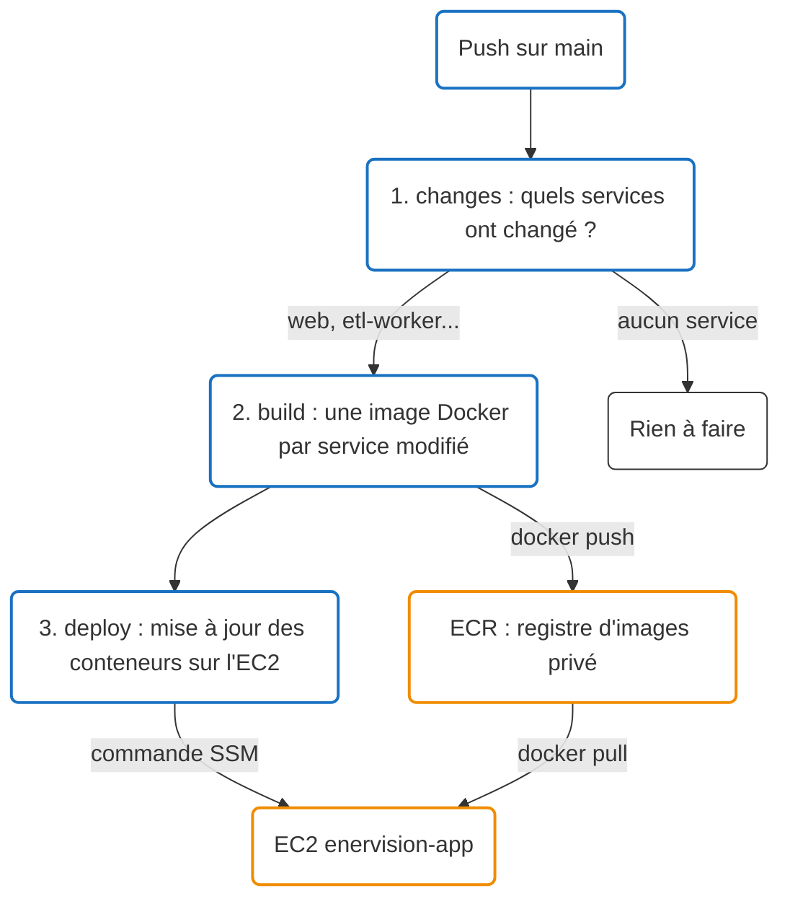
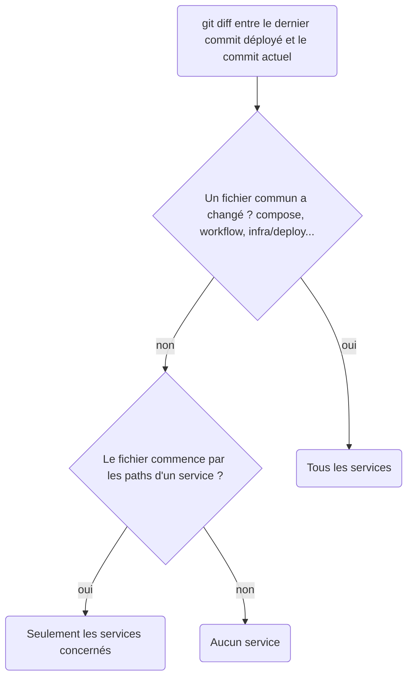
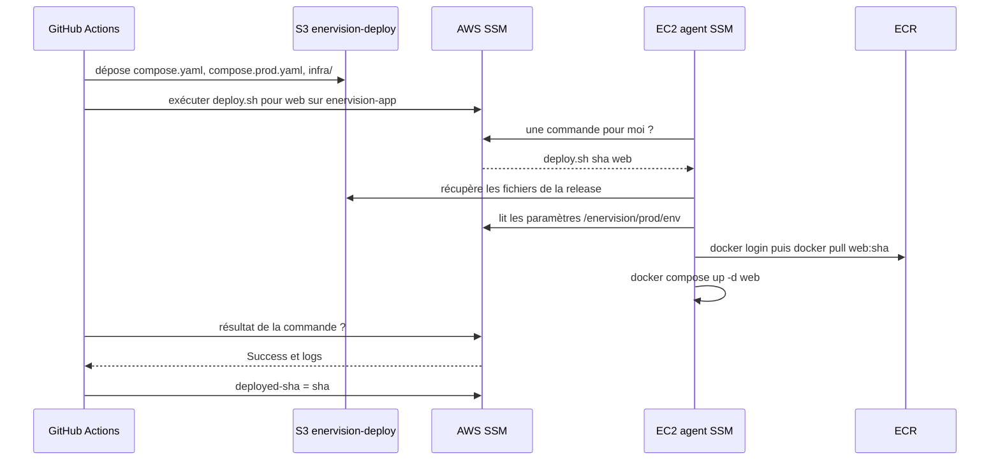
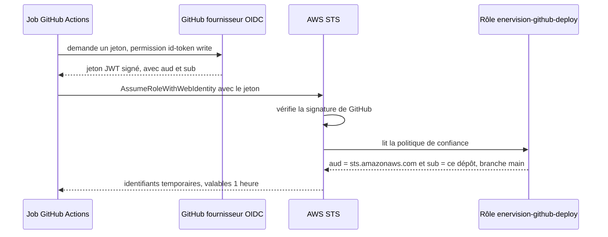
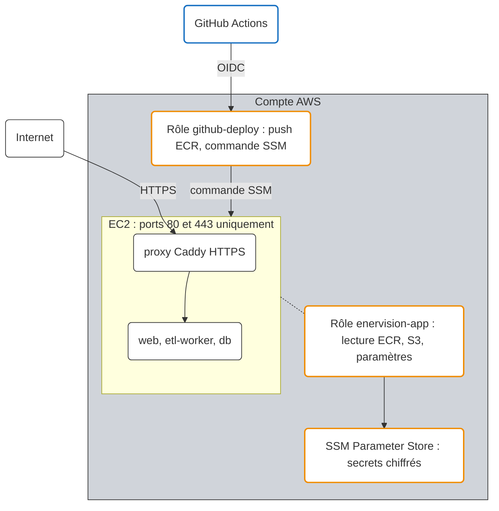

# Comprendre le déploiement

Cette page explique **comment le code de GitHub arrive en production sur AWS** et comment
cet accès est sécurisé. Pour les commandes et la configuration, voir
[Déploiement CI/CD](deploiement.md).

## Vue d'ensemble

À chaque push sur `main`, le workflow `Services` (`.github/workflows/services.yml`) enchaîne
trois jobs :



Sur une PR, seuls les deux premiers jobs tournent : les images sont construites pour vérifier
qu'elles compilent, mais ne sont ni publiées ni déployées.

## 1. `changes` : quels services ont changé ?

Le job compare le commit actuel au **dernier commit déployé avec succès**, mémorisé dans le
paramètre SSM `/enervision/prod/deployed-sha`, puis confronte les fichiers modifiés aux `paths`
de `.github/services.json`.



Exemple : un commit qui ne touche que `app/web/src/...` sélectionne uniquement `web`.

!!! tip "Pourquoi le dernier commit déployé et pas le commit précédent ?"
    Si un déploiement échoue, le paramètre n'est pas mis à jour : le push suivant compare
    donc toujours à la dernière version réellement en production et redéploie aussi ce qui
    avait échoué. Rien n'est perdu.

## 2. `build` : compiler et construire l'image

Il n'y a **pas d'étape de compilation séparée** : la compilation a lieu *dans* le
`docker build`, sur une machine GitHub. Chaque Dockerfile décrit comment compiler son service
(multi-stage build). Par exemple `app/web/Dockerfile` :

```dockerfile
# Étape 1 : image Node, compile l'application Angular
FROM node:24-alpine AS build
RUN npm ci && npm run build          # produit dist/web/browser (HTML, JS, CSS)

# Étape 2 : image finale, uniquement nginx + les fichiers compilés
FROM nginx:1.27-alpine
COPY --from=build /app/dist/web/browser /usr/share/nginx/html
```

L'image finale ne contient ni Node.js ni le code source : seulement ce qui est nécessaire
pour servir l'application. La pipeline, elle, ne connaît que `docker build` puis `docker push` :
un service Java (Maven) ou Python fonctionne de la même façon, seul son Dockerfile change.

Les services sont construits **en parallèle**, un job par service, avec un cache des couches
Docker entre deux runs (les dépendances ne sont pas réinstallées si elles n'ont pas changé).

## Qu'est-ce qu'ECR ?

**ECR (Elastic Container Registry)** est un registre d'images Docker **privé**, hébergé par
AWS : l'équivalent de Docker Hub, mais seules les identités AWS autorisées peuvent y lire ou
y écrire.

Terraform crée **un dépôt ECR par service** ayant un `build` dans `services.json`, dans le
compte EnerVision, région Paris (eu-west-3) :

```
<compte>.dkr.ecr.eu-west-3.amazonaws.com/enervision/web
<compte>.dkr.ecr.eu-west-3.amazonaws.com/enervision/etl-worker
```

Chaque image est poussée avec **deux tags** :

| Tag | Rôle |
|---|---|
| `<sha du commit>` | version exacte et traçable : on sait quel commit tourne en production |
| `latest` | dernière version, utilisée si aucun tag n'est précisé |

ECR garde les **20 dernières images** de chaque dépôt et les **analyse** (scan des
vulnérabilités connues) à chaque push. Les services `proxy` (Caddy) et `db` (TimescaleDB)
utilisent des images publiques : ils n'ont pas de dépôt ECR.

## 3. `deploy` : du dépôt GitHub au serveur

**GitHub ne se connecte jamais directement à l'EC2** : pas de SSH, aucun port d'administration
ouvert. Le déploiement passe par **SSM** (AWS Systems Manager) : un agent installé sur l'EC2
interroge AWS en sortie pour récupérer les commandes à exécuter.



Le serveur ne reçoit **jamais le code source** : seulement les fichiers compose et les images
déjà construites.

### Sur l'EC2

`infra/deploy/deploy.sh` s'exécute dans `/opt/enervision` :

1. reconstruit `.env` à partir des paramètres SSM `/enervision/prod/env/*` (mot de passe de la
   base, URL de l'API…) ;
2. met à jour le tag des **seuls services déployés** dans `deploy.env` (les autres gardent
   leur version) ;
3. se connecte à ECR, puis `docker compose pull` et `docker compose up -d` sur ces services :
   les autres conteneurs ne sont pas redémarrés.

| Fichier sur l'EC2 | Contenu |
|---|---|
| `compose.yaml`, `compose.prod.yaml`, `infra/` | copiés depuis S3 à chaque déploiement |
| `.env` | variables de production, reconstruit depuis SSM (droits `600`) |
| `deploy.env` | registre ECR et tag déployé de chaque service |
| `/var/lib/docker` | volume EBS dédié : images et données TimescaleDB |

## Sécurité : l'accès de GitHub à AWS (OIDC)

### Le problème

L'approche classique consiste à créer un utilisateur IAM et à copier sa clé d'accès dans les
secrets GitHub. Ces clés sont **permanentes** : en cas de fuite (log, dépendance compromise…),
elles donnent accès au compte AWS jusqu'à ce que quelqu'un s'en aperçoive et les révoque.

### La solution : OIDC, sans aucune clé stockée

Avec **OIDC** (OpenID Connect), GitHub prouve à AWS l'identité du workflow avec un jeton signé,
et AWS lui remet des **identifiants temporaires** (1 heure).



Le jeton contient notamment :

| Champ | Valeur | Vérifié par AWS |
|---|---|---|
| `aud` | `sts.amazonaws.com` | le jeton est bien destiné à AWS |
| `sub` | `repo:enervision-project@318340507/smart-energy-optimizer@1425361683:ref:refs/heads/main` | dépôt **et** branche autorisés |

Le rôle n'accepte qu'un seul `sub` : **la branche `main` de ce dépôt**. Une PR, une autre
branche, un fork ou un autre dépôt obtiennent un jeton avec un `sub` différent, refusé par AWS.
C'est pour cela que les PR construisent les images sans pouvoir les publier.

!!! info "Format immuable du `sub`"
    Le dépôt utilise le format **immuable** de GitHub : les noms de l'organisation et du dépôt
    sont suivis de leurs identifiants numériques (`@318340507`, `@1425361683`). Si le dépôt
    était supprimé puis recréé sous le même nom, il aurait un autre identifiant et ne pourrait
    pas déployer. Format à vérifier avec :
    `gh api repos/enervision-project/smart-energy-optimizer/actions/oidc/customization/sub`

### Le moindre privilège

Même avec ce rôle, GitHub ne peut faire que le strict nécessaire :

| Action autorisée | Ressource |
|---|---|
| Pousser des images | les dépôts ECR `enervision/*` |
| Déposer des fichiers | `s3://enervision-deploy-<compte>/releases/*` |
| Envoyer une commande | l'instance `enervision-app`, document `AWS-RunShellScript` |
| Lire et écrire un paramètre | `/enervision/prod/deployed-sha` |

GitHub **ne peut pas** lire les secrets de la base, créer ou supprimer des ressources, ni
accéder au reste du compte.

### Les autres protections



- **Deux rôles distincts** : celui de GitHub (publier, déclencher) et celui de l'EC2 (lire les
  images, les fichiers de release et les secrets). Les secrets ne passent jamais par GitHub.
- **Secrets chiffrés** dans SSM Parameter Store (`SecureString`), mot de passe de la base
  généré par Terraform : il n'est écrit nulle part dans le dépôt.
- **Réseau** : seuls les ports 80 et 443 sont ouverts, vers Caddy. Pas de SSH : l'accès shell
  passe par `aws ssm start-session`, authentifié par le SSO.
- **IMDSv2 obligatoire** et inaccessible depuis les conteneurs : un conteneur compromis ne
  peut pas récupérer les identifiants du rôle de l'instance.

## Dépannage

| Erreur | Cause | Solution |
|---|---|---|
| `Not authorized to perform sts:AssumeRoleWithWebIdentity` | le `sub` du jeton ne correspond pas à la politique de confiance (format, branche) | vérifier `github_oidc_sub_prefix` dans `variables.tf` |
| `not authorized to perform: ssm:GetParametersByPath` | chemin lu différent de celui autorisé (`/env` et `/env/` sont deux ressources IAM différentes) | `deploy.sh` lit `/enervision/prod/env`, sans `/` final |
| `instance enervision-app introuvable` | instance arrêtée ou renommée | `aws ec2 describe-instances --filters Name=tag:Name,Values=enervision-app` |

Commandes utiles :

```bash
gh run list --workflow services.yml          # derniers runs
gh run view <id> --log-failed                # logs du job en échec
aws ssm start-session --target <instance_id> # shell sur l'EC2
# puis, sur l'EC2 :
cd /opt/enervision
sudo docker compose -f compose.yaml -f compose.prod.yaml --env-file .env --env-file deploy.env ps
sudo docker compose -f compose.yaml -f compose.prod.yaml --env-file .env --env-file deploy.env logs -f web
```

!!! note "Revenir à une version précédente"
    Faire un `git revert` du commit fautif sur `main` : la pipeline reconstruit et redéploie
    automatiquement le service concerné.

## Lexique

| Terme | Définition |
|---|---|
| **Image Docker** | paquet figé contenant une application et tout ce qu'il faut pour l'exécuter |
| **ECR** | registre privé AWS où sont stockées les images |
| **EC2** | machine virtuelle AWS qui exécute les conteneurs |
| **SSM** | service AWS pour piloter les serveurs (commandes, sessions) et stocker des paramètres |
| **IAM** | gestion des droits AWS : rôles et politiques |
| **Rôle IAM** | ensemble de droits qu'une identité (GitHub, l'EC2) peut endosser temporairement |
| **OIDC** | protocole qui permet à GitHub de prouver son identité à AWS sans mot de passe ni clé |
| **STS** | service AWS qui délivre les identifiants temporaires |
| **Terraform** | outil qui crée l'infrastructure AWS à partir du code de `infra/terraform/` |
