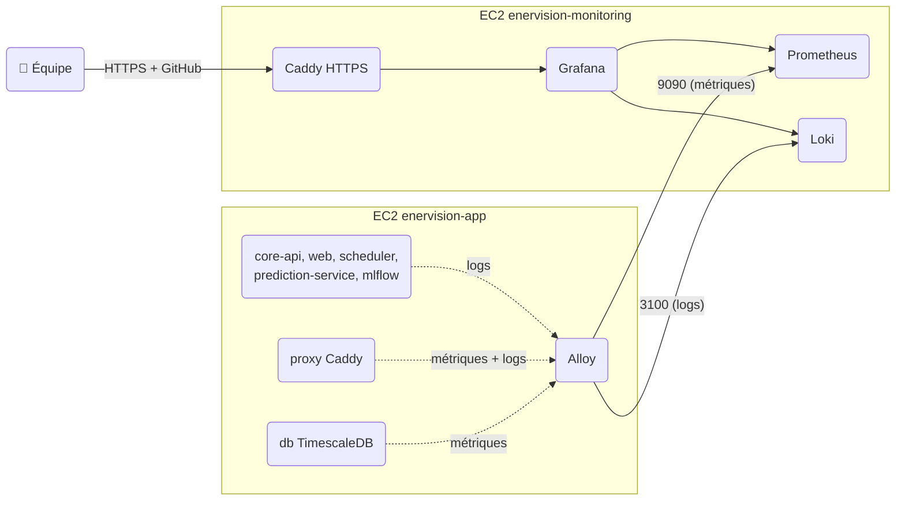

# Monitoring

Le monitoring tourne sur une **EC2 dédiée** (`enervision-monitoring`, t4g.small) avec
Prometheus (métriques), Loki (logs) et Grafana (interface). Sur l'EC2 applicative, **Grafana Alloy**
collecte les métriques et les logs et les pousse vers cette instance.



## Accéder à Grafana

Ouvrir **<https://grafana.ener-vision.click>** et cliquer sur **Sign in with GitHub**.

- Seuls les membres de l'organisation GitHub `enervision-project` peuvent se connecter.
- Le compte Grafana est créé à la première connexion, avec le rôle **Editor**
  (un admin peut ensuite changer le rôle dans *Administration → Users* ; le changement est conservé).
- Seul Grafana est exposé (Caddy, HTTPS Let's Encrypt) : Prometheus et Loki restent privés.

### Secours : compte admin et tunnel SSM

Si la connexion GitHub ne fonctionne pas, le compte local `admin` reste disponible,
sur le domaine public ou par un tunnel SSM :

```bash
cd infra/terraform
terraform output grafana_tunnel   # affiche les deux commandes ci-dessous

# 1. tunnel (laisser tourner), puis ouvrir http://localhost:13000
aws ssm start-session --target <monitoring_instance_id> \
  --document-name AWS-StartPortForwardingSession \
  --parameters portNumber=3000,localPortNumber=13000

# 2. mot de passe admin
aws ssm get-parameter --with-decryption \
  --name /enervision/prod/monitoring/GRAFANA_ADMIN_PASSWORD \
  --query Parameter.Value --output text
```

!!! note "Prérequis pour le tunnel"
    AWS CLI connectée au compte du projet (`aws login`) et
    [plugin Session Manager](https://docs.aws.amazon.com/systems-manager/latest/userguide/session-manager-working-with-install-plugin.html) installé.

### OAuth GitHub

L'application OAuth `EnerVision Grafana` est déclarée dans l'organisation GitHub
(callback `https://grafana.ener-vision.click/login/github`). Son Client ID est dans Terraform
(`grafana_github_client_id`) ; son secret est dans SSM, saisi à la main :

```bash
read -rs GH_SECRET   # coller le secret, rien ne s'affiche
aws ssm put-parameter --overwrite --type SecureString --region eu-west-3 \
  --name /enervision/prod/monitoring/GITHUB_OAUTH_CLIENT_SECRET --value "$GH_SECRET"
unset GH_SECRET
```

Puis redéployer le service `monitoring` (workflow Deploy, lancement manuel).

## Ce qui est collecté

| Source | Données | Collecteur |
| :--- | :--- | :--- |
| Hôte (EC2 app) | CPU, mémoire, disques | Alloy (`prometheus.exporter.unix`) |
| Conteneurs (EC2 app) | CPU, mémoire vs `mem_limit`, démarrages | Alloy (cAdvisor) |
| PostgreSQL | up, connexions, taille des bases | Alloy, rôle `monitoring` (`pg_monitor`) |
| Caddy | requêtes HTTP, codes, latence | Alloy, endpoint interne `proxy:9180` |
| Logs | stdout / stderr de tous les conteneurs de l'EC2 app | Alloy → Loki |

Toutes les séries et tous les logs portent le label `machine` (`app`, ou `monitoring` pour les
métriques internes de Prometheus, Loki et Grafana).
Les logs portent aussi `service` (nom du service compose) et `stream` (`stdout` / `stderr`).

**Rétention** : 15 jours de métriques, 7 jours de logs.

## Dashboard « EnerVision — Overview »

Dossier **EnerVision** dans Grafana. Sections :

- **Hôte** : CPU, mémoire, disques de l'EC2 app
- **Conteneurs** : état des services, mémoire par rapport à `mem_limit`, redémarrages
- **PostgreSQL** : base up, connexions, taille des bases
- **HTTP** : taux de 5xx et latence p95 (site entier via les métriques Caddy, API via les logs d'accès)
- **ETL** : exécutions réussies et échecs par tâche du scheduler (lignes `Fin` / `Échec` de `etl-cron-job`)
- **Logs** : lignes d'erreur par service et dernières erreurs

## Requêtes utiles (Explore)

| Besoin | Requête |
| :--- | :--- |
| Logs d'un service | `{service="core-api"}` |
| Erreurs d'un service | `{service="core-api"} \|~ "(?i)error\|exception"` |
| Exécutions d'une tâche ETL | `{service="scheduler"} \|= "sync-readings"` |
| Requêtes API en erreur | `{service="proxy"} \| json \| request_uri=~"/api/.*" \| status >= 500` |
| Mémoire d'un conteneur | `container_memory_working_set_bytes{container_label_com_docker_compose_service="core-api"}` |
| Disque de l'EC2 app | `node_filesystem_avail_bytes{machine="app", fstype=~"xfs\|ext4"}` |

## Fichiers et déploiement

| Fichier | Rôle |
| :--- | :--- |
| `infra/terraform/monitoring.tf` | EC2, security group, paramètres SSM |
| `infra/monitoring/compose.yaml` | Prometheus, Loki, Grafana, Caddy |
| `infra/monitoring/caddy/Caddyfile` | HTTPS public vers Grafana uniquement |
| `infra/monitoring/grafana/dashboards/` | Dashboards (JSON) chargés au démarrage de Grafana |
| `infra/alloy/config.alloy` | Alloy de l'EC2 app (service `alloy` de `compose.prod.yaml`) |
| `infra/proxy/Caddyfile` | Métriques (`:9180`) et logs d'accès JSON de Caddy |
| `infra/db/changelog/changes/007_monitoring_role.sql` | Rôle PostgreSQL `monitoring` |

Le workflow **Deploy** déploie le service `monitoring` (fichiers `infra/monitoring/`) sur l'EC2
de monitoring, et `alloy` (fichiers `infra/alloy/`) sur l'EC2 app, comme les autres services.

## Modifier ou ajouter

- **Dashboard** : on peut modifier le dashboard dans Grafana, mais les changements ne sont
  pas sauvegardés dans git. Exporter le JSON (*Share → Export*) dans
  `infra/monitoring/grafana/dashboards/`, puis commiter.
- **Nouvelle métrique** : ajouter un composant dans `infra/alloy/config.alloy`
  (par exemple un `prometheus.scrape` vers un endpoint `/metrics`) avec
  `forward_to = [prometheus.remote_write.monitoring.receiver]`.
- **Logs** : rien à faire, tout ce qu'un conteneur écrit sur stdout / stderr est collecté.
  Éviter d'y écrire des secrets (tokens, mots de passe).

## Limites connues

- Pas d'alerting pour l'instant.
- L'EC2 de monitoring ne collecte pas encore ses propres métriques d'hôte (CPU, mémoire, disque) ni ses logs.
- OOM kills non détectés (cAdvisor sans accès à `/dev/kmsg`) ; la mémoire proche de la limite est visible.
- Pas de métriques HTTP pour `prediction-service` (non exposé derrière Caddy) ; ses logs sont dans Loki.
