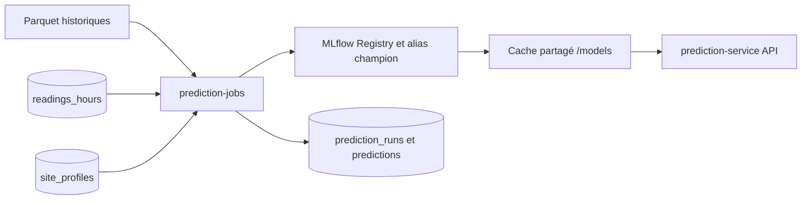

# Fonctionnement du Prediction Service

`prediction-service` prévoit la consommation électrique horaire en kWh. Deux conteneurs utilisent la même image : `prediction-service` sert l'API et garde le modèle champion en mémoire ; `prediction-jobs` entraîne les challengers et produit les prévisions nocturnes. Ils partagent le volume `/models`. Les horaires ci-dessous utilisent `Europe/Paris` ; les heures prédites sont enregistrées comme instants UTC en base.



## Déclenchement des jobs

| Moment | Action |
| --- | --- |
| Chaque jour à **01:00** | Démarre un entraînement HGB. Le calcul s'exécute dans un thread distinct : il ne bloque pas la génération des prévisions. |
| Au démarrage, puis au plus une tentative par heure | Si aucun entraînement réussi n'existe dans MLflow ou si le dernier date de **plus de 25 heures**, lance un entraînement de rattrapage. |
| Dès **01:05**, puis à `:20`, `:35` et `:50` de chaque heure restante | Tente de générer la série quotidienne de 24 prévisions, jusqu'à ce qu'un lot soit publié. |

Le conteneur `prediction-jobs` doit rester démarré pour exécuter ces tâches. La table `prediction_jobs` conserve l'état des tentatives. Un verrou PostgreSQL empêche deux exécutions simultanées d'un même type de job ; la clé du jour évite de republier un lot déjà réussi. Une tentative échouée peut être reprise. Les changements d'heure sont traités à partir des instants UTC : une série contient toujours 24 heures successives.

## Entraînement quotidien

1. Le job lit `train.parquet` et `validation.parquet` historiques depuis `TRAINING_BOOTSTRAP_URI` : `/bootstrap` en local ou un préfixe S3 en production. `test.parquet` reste hors de l'entraînement quotidien. Le script `scripts/ml/upload-bootstrap.sh` sert au transfert initial vers S3.
2. Il lit dans `readings_hours` les consommations non nulles des heures closes. Il n'intègre ces données que lorsque **chaque site historique dispose d'au moins 168 heures SQL valides**. Avant ce seuil, il entraîne sur les Parquet historiques seuls. Quand les heures SQL sont utilisées, `site_profiles` fournit les jours et heures de travail.
3. Il fusionne les sources, trie par date et réserve les **14 derniers jours disponibles** à la validation chronologique. Les sites doivent être présents dans l'entraînement et la validation.
4. Il entraîne un seul challenger `HistGradientBoostingRegressor` avec `site_id`, `hour`, `day_of_week`, `month` et `is_working_hours`. **Ni température ni lags** ne sont utilisés par ce modèle de production.
5. Il enregistre dans MLflow la configuration, la provenance des données, les métriques et le modèle, puis vérifie qu'il peut recharger celui-ci. Chaque challenger obtient une version dans le Model Registry.

La métrique de sélection est `val_macro_nmae_pct`, moyenne des NMAE calculées séparément pour chaque site :

```text
NMAE_site (%) = 100 × moyenne(|réel − prédit|) / moyenne(|réel|)
val_macro_nmae_pct = moyenne(NMAE_site)
```

Le challenger et le champion sont évalués sur **les mêmes lignes de validation**. Sans champion, le premier candidat valide est promu. Sinon, le challenger remplace le champion uniquement si son score est au moins **4 % meilleur relativement** : `score_challenger <= 0,96 × score_champion`, avec un score champion positif. Par exemple, un score champion de 5,00 % demande au plus 4,80 %. Si la NMAE d'un site est indéfinie, la promotion est refusée.

La promotion met à jour l'alias MLflow `champion` et le cache versionné dans `/models/versions/`. Un entraînement réussi peut donc se terminer **sans promotion**. Tant qu'il reste un champion, l'API continue de servir celui qu'elle a déjà chargé pendant le calcul et en cas d'échec du challenger.

## Prévisions nocturnes

Avant le calcul, le job vérifie qu'un agrégat `readings_hours` suffisamment récent existe. Il charge le champion disponible, puis lit `site_profiles`. Un site doit avoir un profil et être connu du modèle ; les sites avec profil mais inconnus du modèle sont signalés puis ignorés. Si aucun site n'est éligible, le lot échoue.

À 01:05, la première heure prévue commence normalement à **02:00** ; les 23 suivantes se suivent d'une heure réelle. Pour chaque site et chaque heure, le job construit les cinq variables du modèle selon l'heure locale, vérifie que la valeur prédite est finie et positive ou nulle, puis écrit le lot entier dans une transaction PostgreSQL.

| Table | Contenu |
| --- | --- |
| `prediction_jobs` | Déclenchement, statut et éventuelle erreur des jobs. |
| `prediction_runs` | Version du modèle, fenêtre de 24 heures, date de génération et taille du lot. |
| `predictions` | `run_id`, `site_id`, `predicted_for` et `prediction_kwh` pour chaque heure. |

Les versions successives des prévisions restent en base. Si le contrôle de fraîcheur, le chargement du champion ou une valeur échoue, aucun lot partiel n'est publié. Si la tentative de 01:05 est retardée, la fenêtre de 24 heures est recalculée à partir du prochain début d'heure au moment de la nouvelle tentative.

## API et chargement du champion

L'API privée expose `GET /health` et `POST /predict`. Au démarrage, elle cherche l'alias `champion` dans MLflow, vérifie et charge sa version. Elle revérifie l'alias toutes les **60 secondes** par défaut et change de modèle sans redémarrer. Si MLflow est indisponible, elle peut charger le dernier modèle en cache. Sans modèle disponible, `/health` annonce `degraded` et `/predict` répond `503`.

`POST /predict` accepte `site_id`, `hour`, `day_of_week` (lundi = 0), `month` et `is_working_hours`. Les deux champs de lag restent optionnels pour la compatibilité avec d'anciens modèles ; le HGB de production les ignore. `temperature_celsius` est refusé. La réponse contient la valeur prédite et la version du modèle chargé.

## Configuration et démarrage local

Les paramètres principaux sont `DATABASE_URL`, `MLFLOW_TRACKING_URI`, `REGISTERED_MODEL_NAME`, `TRAINING_BOOTSTRAP_URI`, `TRAINING_TIMEZONE`, `VALIDATION_DAYS`, `MIN_CURRENT_VALIDATION_HOURS`, `MODEL_DIR` et `MODEL_REFRESH_SECONDS`. Leurs valeurs et usages détaillés figurent dans la section **Prediction Service** de cette documentation.

```bash
docker compose --profile ml up -d db migrate mlflow prediction-service prediction-jobs
curl http://127.0.0.1:8000/health
```

La génération de prévisions nécessite des agrégats récents dans `readings_hours` et des profils dans `site_profiles`. La lecture des prévisions par `core-api` et leur affichage dans Angular ne sont pas encore implémentés.
