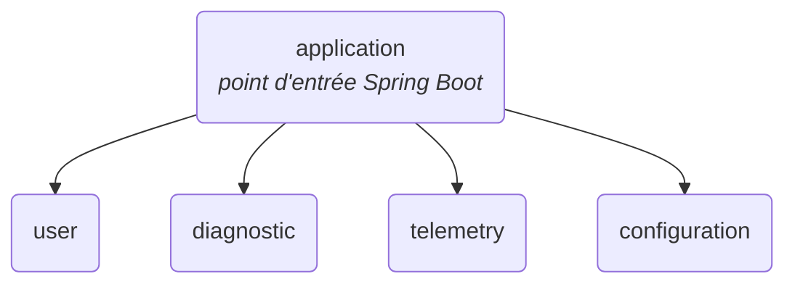

# core-api

API principale d'Enervision, construite comme un **monolithe modulaire** Spring Boot 4 / Java 21 avec Maven multi-modules.

Un seul processus est déployé, mais le code est découpé en modules métier indépendants, chacun dans son propre module Maven. Voir aussi l'[architecture applicative globale](../../docs/doc-technique/architecture-applicative.md).

## Architecture



| Module          | Rôle                                                        | Package racine               |
|-----------------|-------------------------------------------------------------|------------------------------|
| `application`   | Assemble les modules, contient la classe `main` et la config | `com.enervision`             |
| `user`          | Gestion des utilisateurs                                    | `com.enervision.user`        |
| `diagnostic`    | Alertes et recommandations                                  | `com.enervision.diagnostic`  |
| `telemetry`     | Données de télémétrie (appels au ML-service via RestClient) | `com.enervision.telemetry`   |
| `configuration` | Configuration fonctionnelle de la plateforme                | `com.enervision.configuration` |

### Structure Maven

```
core-api/                  pom parent (packaging pom)
├── pom.xml
├── Dockerfile             image de l'API (contexte = racine du dépôt)
├── application/           jar exécutable (spring-boot-maven-plugin)
├── user/                  jar simple
├── diagnostic/            jar simple
├── telemetry/             jar simple
└── configuration/         jar simple
```

- **`pom.xml` (parent)** : hérite de `spring-boot-starter-parent`, déclare les modules, gère les versions des modules internes et de springdoc dans `<dependencyManagement>`, et configure Lombok pour tous les modules.
- **Modules métier** : héritent de `core-api` et produisent un jar classique. Ils ne déclarent **pas** `spring-boot-maven-plugin` (un jar repackagé n'est pas utilisable comme dépendance).
- **`application`** : dépend de tous les modules métier, porte les dépendances runtime (PostgreSQL, DevTools) et produit le jar exécutable final.

### Règles à respecter

- **Versions** : ne pas redéclarer dans `<dependencyManagement>` une dépendance déjà gérée par Spring Boot (starters, Lombok, PostgreSQL…). Une entrée sans version écrase celle du parent et casse le build (`version is missing`).
- **Packages** : tout le code d'un module doit être sous `com.enervision.<module>`. La classe `Application` est dans `com.enervision`, ce qui permet au scan des composants et des entités JPA de trouver tous les modules.
- **Configuration** : un seul `application.yaml`, dans `application/src/main/resources`. Les modules métier ne doivent pas en avoir (un seul serait chargé sur le classpath).
- **Dépendances entre modules** : un module métier ne dépend pas d'`application`. Si un module doit en utiliser un autre, déclarer la dépendance dans son `pom.xml` et éviter les cycles.

## Base de données

core-api utilise la base TimescaleDB (PostgreSQL 16) du service `db`, défini dans le [`compose.yaml` racine](../../compose.yaml).

- **Schéma** : géré par [`infra/db/init.sql`](../../infra/db/init.sql), exécuté uniquement au premier démarrage du conteneur (volume vide). Hibernate est en `ddl-auto: validate` : il ne crée ni ne modifie aucune table, il vérifie seulement que les entités JPA correspondent au schéma. Toute évolution du schéma passe donc par `init.sql`, puis par une recréation du volume (`docker compose down -v`).
- **Connexion** : configurée dans `application/src/main/resources/application.yaml` via les variables `SPRING_DATASOURCE_URL`, `SPRING_DATASOURCE_USERNAME` et `SPRING_DATASOURCE_PASSWORD`. Sans ces variables, les valeurs par défaut pointent vers la base exposée sur l'hôte (`localhost:15432`, identifiants du `.env.example`).

## Build et exécution

Prérequis : Java 21, Docker avec les plugins Compose v2 et Buildx (le Dockerfile utilise un cache BuildKit). Les commandes `docker compose` se lancent depuis la racine du dépôt, après `cp .env.example .env`.

### Dev local (app lancée depuis l'IDE ou Maven)

```bash
# Depuis la racine du dépôt : démarrer uniquement la base
docker compose up -d db

# Depuis services/core-api : lancer l'application
./mvnw -pl application -am spring-boot:run
```

### Stack complète en conteneurs

```bash
# Depuis la racine du dépôt
docker compose up --build
```

L'API est alors disponible sur http://localhost:8080. Le service `core-api` attend que `db` soit healthy, puis s'y connecte via le réseau Compose (hôte `db`), avec les identifiants `POSTGRES_*` du `.env`.

L'image est construite par [`Dockerfile`](Dockerfile), avec la racine du dépôt comme contexte (même convention que `etl-worker`) : une étape Maven produit le jar, puis une image JRE 21 seule l'exécute.

### Maven

```bash
# Compiler tous les modules
./mvnw clean compile

# Construire le jar exécutable (sans les tests)
./mvnw clean package -DskipTests

# Lancer le jar
java -jar application/target/application-0.0.1-SNAPSHOT.jar
```

## Tests

```bash
./mvnw clean verify
```

> **Note** : aucune base de données n'est encore configurée. Le démarrage et le test `ApplicationTests.contextLoads` échouent tant que `spring.datasource.*` n'est pas renseigné (PostgreSQL via `compose.yaml` ou Testcontainers).

## Ajouter un module

1. Créer le dossier `<module>/` avec un `pom.xml` qui a `core-api` comme parent.
2. L'ajouter dans `<modules>` et dans `<dependencyManagement>` du `pom.xml` parent.
3. L'ajouter comme dépendance dans `application/pom.xml`.
4. Placer le code sous `com.enervision.<module>`.

## Références

- [Spring Boot 4.1.1](https://docs.spring.io/spring-boot/4.1.1/)
- [Spring Boot Maven Plugin](https://docs.spring.io/spring-boot/4.1.1/maven-plugin)
- [Maven multi-modules](https://maven.apache.org/guides/mini/guide-multiple-modules.html)
- [SpringDoc OpenAPI](https://springdoc.org/)
