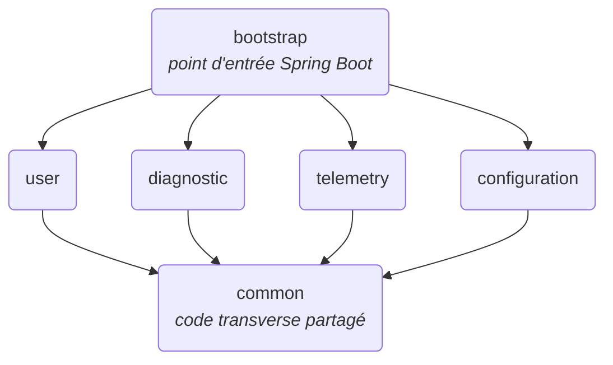

# core-api

API principale d'Enervision, construite comme un **monolithe modulaire** Spring Boot 4 / Java 21 avec Maven multi-modules.

Un seul processus est déployé, mais le code est découpé en modules métier indépendants, chacun dans son propre module Maven. Voir aussi l'[architecture applicative globale](../../docs/doc-technique/architecture-applicative.md).

## Architecture



| Module          | Rôle                                                        | Package racine               |
|-----------------|-------------------------------------------------------------|------------------------------|
| `bootstrap`     | Assemble les modules, contient la classe `main` et la config | `com.enervision`             |
| `common`        | Code transverse partagé : utilisateur courant, rôles, `@AdminOnly` | `com.enervision.common` |
| `user`          | Gestion des utilisateurs                                    | `com.enervision.user`        |
| `diagnostic`    | Alertes et recommandations                                  | `com.enervision.diagnostic`  |
| `telemetry`     | Données de télémétrie (appels au ML-service via RestClient) | `com.enervision.telemetry`   |
| `configuration` | Sites, profils de référence et visibilité des sites par utilisateur | `com.enervision.configuration` |

### Structure Maven

```
core-api/                  pom parent (packaging pom)
├── pom.xml
├── Dockerfile             image de l'API (contexte = racine du dépôt)
├── bootstrap/             jar exécutable (spring-boot-maven-plugin)
├── common/                jar simple, dont dépendent tous les modules métier
├── user/                  jar simple
├── diagnostic/            jar simple
├── telemetry/             jar simple
└── configuration/         jar simple
```

- **`pom.xml` (parent)** : hérite de `spring-boot-starter-parent`, déclare les modules, gère les versions des modules internes et de springdoc dans `<dependencyManagement>`, et configure Lombok pour tous les modules.
- **Modules métier** : héritent de `core-api` et produisent un jar classique. Ils ne déclarent **pas** `spring-boot-maven-plugin` (un jar repackagé n'est pas utilisable comme dépendance).
- **`common`** : code transverse utilisé par plusieurs modules (sécurité : `CurrentUser`, `Role`, `@AdminOnly`). **Pas de logique métier**, pas d'entité ni de repository ; il ne dépend d'aucun module interne, ce qui exclut tout cycle.
- **`bootstrap`** : dépend de tous les modules métier, porte les dépendances runtime (PostgreSQL, DevTools) et produit le jar exécutable final.

### Règles à respecter

- **Versions** : ne pas redéclarer dans `<dependencyManagement>` une dépendance déjà gérée par Spring Boot (starters, Lombok, PostgreSQL…). Une entrée sans version écrase celle du parent et casse le build (`version is missing`).
- **Packages** : tout le code d'un module doit être sous `com.enervision.<module>`. La classe `Application` est dans `com.enervision`, ce qui permet au scan des composants et des entités JPA de trouver tous les modules.
- **Configuration** : un seul `application.yaml`, dans `bootstrap/src/main/resources`. Les modules métier ne doivent pas en avoir (un seul serait chargé sur le classpath).
- **Dépendances entre modules** : un module métier ne dépend pas de `bootstrap`. Si un module doit en utiliser un autre, déclarer la dépendance dans son `pom.xml` et éviter les cycles.

## Base de données

core-api utilise la base TimescaleDB (PostgreSQL 16) du service `db`, défini dans le [`compose.yaml` racine](../../compose.yaml).

- **Schéma** : géré par les changesets Liquibase de [`infra/db/changelog/`](../../infra/db/changelog/changelog.yaml), appliqués par le service `migrate` à chaque `docker compose up` (core-api attend sa fin). Hibernate est en `ddl-auto: validate` : il ne crée ni ne modifie aucune table, il vérifie seulement que les entités JPA correspondent au schéma. Toute évolution du schéma passe donc par un **nouveau** fichier dans `infra/db/changelog/changes/`, ajouté à la fin de `changelog.yaml` ; un changeset déjà déployé ne se modifie jamais.
- **Connexion** : via les variables `SPRING_DATASOURCE_URL`, `SPRING_DATASOURCE_USERNAME` et `SPRING_DATASOURCE_PASSWORD`, lues directement par Spring Boot. `application.yaml` ne contient aucune valeur par défaut : en conteneur, `compose.yaml` les fournit ; en local, le `.env` racine (voir [Configuration et secrets](#configuration-et-secrets)).

### Tables du module configuration

core-api ne fait que **lire** ces tables (entités `@Immutable`) ; aucun endpoint n'y écrit.

| Table | Rempli par | Contenu |
|---|---|---|
| `sites` | ETL worker (API énergie) | Sites suivis, clé `site_id` (`SITE001`…) |
| `site_profiles` | ETL worker (`sync-site-profiles` : à chaque démarrage et à 16 h 01) | Profil de référence, au plus un par site (clé = `site_id`) |
| `users_sites` | Seed (à venir) | Sites visibles par chaque `USER` ; un `ADMIN` n'y a aucune ligne |

Les profils viennent de la clé `profile` des fichiers `*_metadata.json` du jeu de données (pas d'endpoint dans l'API énergie). Ils sont versionnés dans [`services/etl-worker/src/etl_worker/data/site_profiles.json`](../etl-worker/src/etl_worker/data/site_profiles.json), au format source (jours `0` = lundi, `working_hours: [début, fin]`), et convertis par l'ETL au chargement. Pour modifier un profil, éditer ce fichier : le prochain démarrage de l'ETL met la base à jour (ou à la main : `docker compose run --rm etl-worker sync-site-profiles`). Un échec de chargement est signalé dans les logs sans bloquer la collecte.

Conventions de `site_profiles`, contrôlées par des `CHECK` :
- `base_consumption` / `peak_consumption` en kW, avec `peak_consumption >= base_consumption`.
- `working_hour_start` / `working_hour_end` : plage `[début, fin[` en heures ; `0` / `24` pour un site actif 24h/24.
- `working_days` : numérotation **ISO**, `1` = lundi … `7` = dimanche (comme `DayOfWeek` en Java et `ISODOW` en SQL). L'API les renvoie en noms (`["MONDAY", …]`).
- `seasonal_variation`, `noise_level` : ratios (`0.15` = ±15 %).
- `weekend_factor` : multiplicateur de consommation le week-end (`1.2` = +20 %), `NULL` si le site n'en a pas.

## Build et exécution

Prérequis : Java 21, Docker avec les plugins Compose v2 et Buildx (le Dockerfile utilise un cache BuildKit). Les commandes `docker compose` se lancent depuis la racine du dépôt, après `cp .env.example .env`.

### Dev local (app lancée depuis l'IDE ou Maven)

```bash
# Depuis la racine du dépôt : démarrer la base et appliquer le schéma (Liquibase)
docker compose up -d migrate

# Depuis services/core-api : construire puis lancer l'application
./mvnw clean package -DskipTests
java -jar bootstrap/target/bootstrap-0.0.1-SNAPSHOT.jar
```

L'application lit automatiquement le `.env` racine (`spring.config.import: optional:file:../../.env[.properties]`), à condition d'être lancée **depuis `services/core-api`**. Dans l'IDE, le répertoire de travail de la configuration de lancement doit donc être `services/core-api`. Sinon le `.env` n'est pas trouvé, et l'application refuse de démarrer avec un message indiquant la propriété manquante.

### Stack complète en conteneurs

```bash
# Depuis la racine du dépôt
docker compose up --build
```

L'API est alors disponible sur http://localhost:8080. Le service `core-api` attend que `db` soit healthy, puis s'y connecte via le réseau Compose (hôte `db`), avec les identifiants `POSTGRES_*` du `.env`. `JWT_SECRET` doit être renseigné dans le `.env` : sinon `docker compose` refuse de démarrer.

L'image est construite par [`Dockerfile`](Dockerfile), avec la racine du dépôt comme contexte (même convention que `etl-worker`) : une étape Maven produit le jar, puis une image JRE 21 seule l'exécute.

### Maven

```bash
# Compiler tous les modules
./mvnw clean compile

# Construire le jar exécutable (sans les tests)
./mvnw clean package -DskipTests

# Lancer le jar
java -jar bootstrap/target/bootstrap-0.0.1-SNAPSHOT.jar
```

## Sécurité

Authentification **stateless par jeton JWT** (Bearer, signé en HS256), avec Spring Security en resource server.

| Où | Quoi |
|---|---|
| `bootstrap` — `com.enervision.config.SecurityConfig` | Règles communes à tous les modules : tout endpoint exige un jeton valide, sauf les routes publiques (login, doc OpenAPI). Active `@PreAuthorize` et déclare le schéma Bearer dans la doc OpenAPI. |
| `user` — `com.enervision.user.security` | Fournisseur d'identité : émission des jetons (`TokenService`), vérification (`JwtDecoder`), conversion des rôles, hash des mots de passe (BCrypt), chargement des utilisateurs pour le login. |
| `common` — `com.enervision.common.security` | Partagé par tous les modules : `Role`, `@AdminOnly`, et `CurrentUser` (l'utilisateur de la requête, injecté dans les controllers). |

### Endpoints

| Méthode | Route | Accès |
|---|---|---|
| `POST` | `/api/v1/auth/login` | Public : renvoie `{ accessToken, tokenType, expiresIn }` |
| `GET` | `/api/v1/users/me` | Connecté |
| `GET` | `/api/v1/users`, `/api/v1/users/{userId}` | `ADMIN` |
| `PATCH` | `/api/v1/users/{userId}/role` | `ADMIN` |
| `GET` | `/api/v1/sites` | Connecté : sites visibles par l'utilisateur |
| `GET` | `/api/v1/sites/{siteId}` | Connecté : site et son profil de référence (`profile` à `null` si aucun profil n'est chargé) |

Les appels authentifiés envoient l'en-tête `Authorization: Bearer <accessToken>`. Le jeton contient l'id de l'utilisateur (`sub`), son email et ses rôles (`roles`). La doc interactive est sur http://localhost:8080/swagger-ui.html (bouton « Authorize »).

### Rôles

`USER` et `ADMIN` (enum `Role`, module `common`), exposés à Spring Security sous la forme `ROLE_USER` / `ROLE_ADMIN` (`Role.authority()`). Pour restreindre un endpoint aux administrateurs, utiliser la méta-annotation `@AdminOnly` (`com.enervision.common.security`) plutôt qu'un `@PreAuthorize("hasRole('ADMIN')")` écrit à la main :

```java
@AdminOnly
@GetMapping
public List<SiteResponse> getSites() { … }
```

Une route publique se déclare dans `SecurityConfig` (module `bootstrap`).

### Utilisateur courant

Un controller qui a besoin de l'utilisateur connecté déclare un paramètre `CurrentUser` (`com.enervision.common.security`) : il est construit à partir de l'authentification Spring Security (id = `sub` du jeton, rôle = autorité `ROLE_*`) puis passé au service.

```java
@GetMapping
public List<SiteSummaryResponse> getSites(CurrentUser currentUser) {
	return siteService.getSites(currentUser);
}
```

`currentUser.id()` donne l'id de l'utilisateur, `currentUser.isAdmin()` son rôle.

### Visibilité des sites

Un `ADMIN` voit tous les sites. Un `USER` ne voit que les sites qui lui sont attribués dans la table `users_sites` ; un site non attribué répond 404, comme un site inexistant, pour ne pas révéler son existence. Les autres modules vérifient l'accès via `SiteService.canView(currentUser, siteId)` (module `configuration`).

> **Comptes** : il n'y a pas d'inscription. Les utilisateurs sont les membres de l'équipe, créés directement en base, et ont accès à tous les sites (pas d'isolation par utilisateur pour l'instant). Le mot de passe stocké doit porter le préfixe de son encodeur (`DelegatingPasswordEncoder`) : `{bcrypt}$2a$10$…` (recommandé), ou `{noop}motdepasse` en dev uniquement. Sans préfixe, le login échoue.

## Configuration et secrets

**Aucun secret n'est versionné.** `application.yaml` ne contient que des valeurs non sensibles ; les secrets n'ont pas de valeur par défaut, et l'application refuse de démarrer s'ils manquent (message explicite au démarrage).

| Variable | Secret | Défaut | Rôle |
|---|---|---|---|
| `SPRING_DATASOURCE_URL` | Non | aucun | URL JDBC de la base |
| `SPRING_DATASOURCE_USERNAME` | Non | aucun | Utilisateur de la base |
| `SPRING_DATASOURCE_PASSWORD` | **Oui** | aucun | Mot de passe de la base |
| `JWT_SECRET` | **Oui** | aucun | Clé HMAC encodée en Base64, 32 octets minimum (`openssl rand -base64 32`). Une clé différente par environnement. |
| `JWT_EXPIRATION` | Non | `1h` | Durée de validité d'un jeton |

Où vivent les valeurs selon l'environnement :

| Environnement | Source | Versionné ? |
|---|---|---|
| Dev local (IDE, `java -jar`) | `.env` à la racine du dépôt, créé à partir de `.env.example`, importé par Spring au démarrage | Non (gitignoré, exclu des images Docker) |
| Stack Compose | Même `.env` ; `compose.yaml` passe les variables au conteneur (avec l'hôte `db` pour la base) | Non (gitignoré) |
| CI / déploiement | Secrets de la plateforme (ex. GitHub Secrets transmis par le workflow de déploiement), injectés en variables d'environnement | Non |

## Tests et qualité

```bash
# Avant de pousser : formatage, tests, couverture (ce que lance la CI)
./mvnw clean verify

# Corriger le formatage signalé par verify
./mvnw spotless:apply
```

`verify` échoue si l'un de ces contrôles, configurés dans le `pom.xml` parent, n'est pas respecté :

| Contrôle | Outil | Règle |
|---|---|---|
| Tests unitaires | Surefire | Classes `*Test` |
| Tests d'intégration | Failsafe | Classes `*IT` (Testcontainers : Docker requis) |
| Formatage | Spotless (formateur Eclipse, profil [`eclipse-formatter.xml`](eclipse-formatter.xml)) | Tabulations, 120 colonnes, retours à la ligne écrits à la main conservés |

Le code sans logique à tester est exclu de la couverture : `Application`, `config/`, `*Config`, `*Properties`, `dto/`, `entity/`, `exception/`. La liste est en double dans le `pom.xml` (excludes JaCoCo et `sonar.coverage.exclusions`) : les garder identiques.

La couverture est mesurée par JaCoCo mais ne fait pas échouer `verify` : le minimum est imposé par la quality gate SonarCloud (80 % sur le nouveau code de chaque PR). Chaque module écrit son rapport dans `<module>/target/site/jacoco/` (HTML `index.html`, et `jacoco.xml` lu par Sonar). Seuls les tests d'un module comptent pour sa couverture.

### CI

À chaque PR qui modifie `services/core-api/` ou `infra/db/changelog/`, le workflow [`_ci-core-api.yml`](../../.github/workflows/_ci-core-api.yml) (appelé par `ci.yml`) lance `./mvnw verify`, puis l'analyse SonarCloud (projet `enervision-project_smart-energy-optimizer_core_api`, quality gate : 80 % de couverture sur le nouveau code). L'analyse Sonar est ignorée tant que le secret `SONAR_TOKEN_CORE_API` n'existe pas. En cas d'échec, les rapports de tests sont disponibles en artefact du run.

## Ajouter un module

1. Créer le dossier `<module>/` avec un `pom.xml` qui a `core-api` comme parent.
2. L'ajouter dans `<modules>` et dans `<dependencyManagement>` du `pom.xml` parent.
3. L'ajouter comme dépendance dans `bootstrap/pom.xml`.
4. Lui ajouter la dépendance `common` (utilisateur courant, rôles, `@AdminOnly`).
5. Placer le code sous `com.enervision.<module>`.

## Références

- [Spring Boot 4.1.1](https://docs.spring.io/spring-boot/4.1.1/)
- [Spring Boot Maven Plugin](https://docs.spring.io/spring-boot/4.1.1/maven-plugin)
- [Maven multi-modules](https://maven.apache.org/guides/mini/guide-multiple-modules.html)
- [SpringDoc OpenAPI](https://springdoc.org/)
