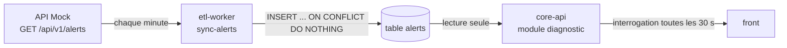

# Alertes (module diagnostic)

Conception du module `diagnostic` de core-api pour la partie alertes (EPIC-4).
Décisions prises le 2026-10-22.

## D'où viennent les alertes



- L'ETL `sync-alerts` appelle `GET /api/v1/alerts` une fois par minute et insère les alertes reçues dans la table `alerts` (changeset `002`). Il n'y a ni mise à jour ni suppression.
- core-api lit cette table. Il n'écrit jamais dedans.

## Comportement de l'API Mock

Le sujet présente `GET /api/v1/alerts` comme la liste des « alertes de consommation actives ». En pratique, **les alertes sont tirées au hasard à chaque appel** (observé le 2026-10-22 sur une vingtaine d'appels) :

```text
11:07:16  ALR-SITE001-1792667224 critical/outage   ALR-SITE002-1792667224 high/spike   ALR-SITE004-1792667224 high/spike
11:07:20  ALR-SITE002-1792667228 medium/anomaly    ALR-SITE005-1792667228 medium/anomaly
11:07:24  ALR-SITE002-1792667232 medium/threshold  ALR-SITE005-1792667232 high/spike
```

| Champ | Comportement |
|---|---|
| nombre d'alertes | entre 0 et 4 par appel |
| `alert_id` | `ALR-<site>-<heure de l'appel en secondes Unix>` : un identifiant ne revient jamais d'un appel à l'autre |
| `site_id`, `severity`, `type` | aléatoires |
| `timestamp` | date aléatoire dans l'heure qui précède l'appel, en UTC sans fuseau (l'ETL la convertit correctement) |
| `threshold` | fixe pour chaque site (720 pour Usine Lyon Vénissieux, 135 pour Bureau Paris La Défense) |
| `value` | toujours au-dessus de `threshold`, de 10 à 40 % environ |
| `message` | phrase type selon `type`, suivie du nom du site (« Pic de consommation détecté sur … », « Risque de surcharge sur … ») |

Conséquences :

- On ne peut pas suivre une alerte dans le temps : il n'y a pas de cycle de vie active / résolue, et une alerte absente de l'API ne veut pas dire qu'elle est résolue.
- La table `alerts` reçoit un **échantillon aléatoire** d'environ 2 alertes par minute (près de 3 000 par jour), sans doublon.

!!! info "Revérifier ce comportement"
    ```bash
    for i in $(seq 1 10); do
      curl -s "$ENERGY_API_BASE_URL/api/v1/alerts" | python3 -c \
        "import json,sys; print([(a['alert_id'], a['timestamp'], a['severity'], a['type']) for a in json.load(sys.stdin)])"
      sleep 5
    done
    ```
    Côté base, nombre d'alertes chargées par heure (environ 120 à 150 attendues) :
    ```sql
    SELECT date_trunc('hour', loaded_at) AS heure, count(*), count(DISTINCT site_id)
    FROM alerts GROUP BY 1 ORDER BY 1 DESC LIMIT 24;
    ```

    Si l'API Mock change (identifiants stables, alertes qui durent), revoir la décision 2.

## Décisions

1. **Pas d'acquittement ni de statut** (Nouvelle / Prise en charge / Résolue dans la maquette) : sans identifiant stable, il n'y a rien à acquitter. L'issue #49 « Marquer une alerte comme vue » est à fermer ou à réécrire avec le PO.
2. **Alerte récente = `timestamp` dans la dernière heure**, la même fenêtre que celle de l'API Mock. core-api fait ce calcul au moment de la requête : pas de nouveau changeset, pas de modification de l'ETL.
3. **Lecture seule** : l'entité `Alert` est `@Immutable` et aucun endpoint n'écrit.
4. **Visibilité** : un `USER` ne voit que les alertes de ses sites, un `ADMIN` voit tout. Ce filtre passe par `SiteService` du module `configuration` (PR #129, à merger avant).
5. **Relais vers l'utilisateur (#46)** : le front interroge l'API toutes les 30 s. Pas de SSE ni de WebSocket : l'ETL ne synchronise qu'une fois par minute, le temps réel n'apporterait rien et compliquerait le proxy, la sécurité JWT et les tests.
6. **Hors périmètre** :
    - la matrice d'état des capteurs et leur fiabilité sur 7 jours (maquette wf4) : ces données viennent de `readings_raws` (`data_quality`, `null_reasons`), elles relèvent du module `telemetry` et feront l'objet d'une story séparée ;
    - le bouton « Simuler un pic » (`POST /api/v1/simulate/spike/{site_id}`) : mis de côté pour l'instant.

## Contrat d'API

JSON en camelCase, comme le reste de core-api. Les dates sont en ISO 8601 UTC.

### `GET /api/v1/alerts`

Liste paginée, triée par `timestamp` décroissant.

| Paramètre | Défaut | Description |
|---|---|---|
| `siteId` | tous les sites visibles | un site ; `403` s'il n'est pas visible par l'utilisateur |
| `severity` | toutes | `low`, `medium`, `high`, `critical`, plusieurs valeurs possibles ; `400` si la valeur est inconnue |
| `type` | tous | `spike`, `threshold`, `anomaly`, `outage`, `sensor`, plusieurs valeurs possibles ; `400` si la valeur est inconnue |
| `from` / `to` | dernière heure / maintenant | intervalle sur `timestamp` |
| `page` / `size` | `0` / `50` | pagination Spring Data, `size` limité à 200 |

```json
{
  "content": [
    {
      "alertId": "ALR-SITE002-1792667216",
      "siteId": "SITE002",
      "siteName": "Usine Lyon Vénissieux",
      "timestamp": "2026-10-22T10:38:56Z",
      "severity": "high",
      "type": "spike",
      "message": "Pic de consommation détecté sur Usine Lyon Vénissieux",
      "value": 912.5,
      "threshold": 720.0,
      "recent": true
    }
  ],
  "page": { "size": 50, "number": 0, "totalElements": 1, "totalPages": 1 }
}
```

`recent` vaut `true` si `timestamp` date de moins d'une heure.

Couvre #45 (alertes d'un site triées), #51 (sévérité) et #50 (type).

### `GET /api/v1/alerts/summary`

Nombre d'alertes récentes (dernière heure) par sévérité, pour le badge du menu et la vue d'ensemble. Accepte `siteId`.

```json
{
  "since": "2026-10-22T10:07:00Z",
  "total": 7,
  "bySeverity": { "low": 2, "medium": 3, "high": 1, "critical": 1 }
}
```

Couvre #46 avec l'interrogation régulière du front.

## Points d'implémentation

- La colonne s'appelle `timestamp`, un mot réservé : `@Column(name = "\"timestamp\"")`.
- `severity` et `type` sont du `TEXT` sans contrainte `CHECK`. Une valeur inconnue en base ne doit pas faire échouer toute la liste : convertisseur tolérant (valeur `unknown`) ou `String` dans l'entité, enum dans le DTO.
- Tri par sévérité : enum ordonné `LOW < MEDIUM < HIGH < CRITICAL`.
- L'index `(site_id, "timestamp" DESC)` du changeset `002` couvre les requêtes par site et par période.
- `siteName` : obtenu avec `SiteService.getSites(currentUser)`, qui fournit aussi la liste des sites visibles.
- Structure du module selon `.claude/skills/java-conventions` : controller, interface de service, implémentation package-private dans `service.implementation`, `@Transactional(readOnly = true)`.

## À faire en dehors du module

- **PO** : fermer ou réécrire #49, fermer #47 (doublon de #51), préciser #19 ou le rattacher à #51.
- **Front** : `core/models/alert.ts` passe en camelCase (`alertType` devient `type`, `site_id` devient `siteId`). `viewed_at` disparaît, remplacé par `recent`.
- **ETL** : préciser dans la doc de `sync-alerts` que l'API Mock renvoie un échantillon aléatoire et non des alertes persistantes.
- **Prod** : core-api n'est pas encore déployé (`services.json`, `compose.prod.yaml`, route `/api` dans Caddy).
