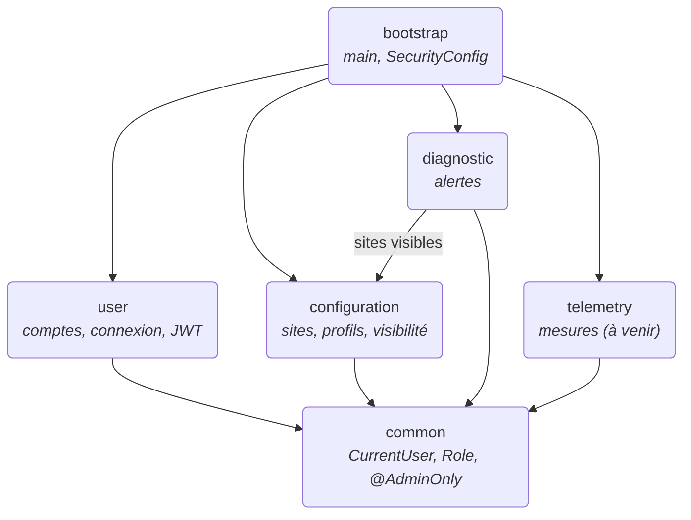
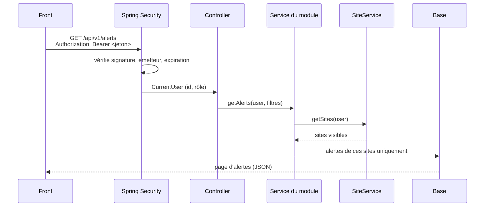

# Core API

API principale d'EnerVision : un **monolithe modulaire** Spring Boot 4 / Java 21. Un seul processus est déployé, mais le code est découpé en modules Maven indépendants. Le [README du service](https://github.com/enervision-project/smart-energy-optimizer/blob/main/services/core-api/README.md) détaille la structure Maven, le build, la configuration et les tests.

## Modules

| Module | Endpoints | Documentation |
|---|---|---|
| `user` | `POST /api/v1/auth/login`, `/api/v1/users/**` | [Sécurité](securite.md) |
| `configuration` | `/api/v1/sites/**` | [Sécurité › visibilité des sites](securite.md#visibilite-des-sites) |
| `diagnostic` | `/api/v1/alerts/**` | [Alertes](alertes.md) |
| `telemetry` | (à venir) | — |

La documentation interactive des endpoints (Swagger UI) est disponible en local sur http://localhost:8080/swagger-ui.html ; elle est désactivée en production.

## Données

core-api lit la base TimescaleDB alimentée par l'ETL (`sites`, `site_profiles`, `alerts`, mesures) et ne gère lui-même que les comptes (`users`, `users_sites`). Le schéma est géré par Liquibase (`infra/db/changelog/`) ; Hibernate se contente de le valider au démarrage.

## Requête type

