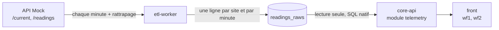

# Mesures (module telemetry)

Routes de lecture des mesures pour le dashboard : courbe d'un site, dernière mesure, synthèse sur une période et consommation actuelle du parc. Les capteurs (`/sensors/status`, `/sensors/reliability`, maquette wf4) feront l'objet d'une PR séparée.

## D'où viennent les mesures

- L'ETL écrit une ligne par site et par minute dans `readings_raws` : valeurs brutes (NULL compris), `null_reasons`, `data_quality`, origine (`source`) et consommation imputée (`consumption_kw_imputed`, `imputation_method`). Voir la [documentation de l'ETL](https://github.com/enervision-project/smart-energy-optimizer/blob/main/services/etl-worker/docs/index.md).
- core-api ne lit que `readings_raws`, y compris pour les pas d'une heure : tous les champs (qualité, imputation, raisons des NULL) restent disponibles quel que soit le pas, et une heure récente est à jour sans attendre `sync-hours`. `readings_hours` reste la table du ML.
- Les requêtes sont en SQL natif (`JdbcClient`) : agrégats par pas (`date_bin`) et tableaux PostgreSQL ne passent pas en JPQL.

## Routes

Toutes en lecture seule, derrière le JWT. Un site que l'utilisateur ne voit pas (ou qui n'existe pas) renvoie **404**, comme pour les alertes. Dates en ISO 8601 UTC, JSON en camelCase.

| Route | Rôle | Maquette |
|---|---|---|
| `GET /api/v1/sites/{siteId}/readings?from&to&step` | Courbe : un point par pas | wf2 ② ③ |
| `GET /api/v1/sites/{siteId}/readings/latest` | Dernière mesure (204 si aucune) | wf2 ① |
| `GET /api/v1/sites/{siteId}/readings/summary?from&to` | Énergie, pic, disponibilité | wf2, synthèse |
| `GET /api/v1/stats/summary` | Consommation actuelle des sites visibles | wf1 |

### Courbe : `/sites/{siteId}/readings`

| Paramètre | Valeurs | Défaut |
|---|---|---|
| `step` | `1m`, `15m`, `1h` | `15m` |
| `from`, `to` | ISO 8601 | les 48 dernières heures |

- La période est alignée sur le pas en UTC : `from` arrondi au pas inférieur, `to` au pas supérieur (exclu).
- Période maximale : 48 h en `1m`, 31 jours en `15m`, 366 jours en `1h`. Au-delà, ou si `from` n'est pas avant `to` : **400**.
- **Tous les pas de la période sont renvoyés**, y compris ceux sans mesure (valeurs `null`, `minutesReceived = 0`) : le front dessine les trous.

| Champ d'un point | Calcul |
|---|---|
| `consumptionKw` | moyenne des valeurs **brutes** du pas |
| `consumptionKwImputed` | moyenne des valeurs brutes complétées par les valeurs imputées : la ligne pointillée |
| `voltageV`, `currentA`, `powerFactor`, `temperatureCelsius`, `humidityPercent` | moyennes de leurs valeurs non NULL |
| `dataQuality` | pire qualité du pas (`good` < `partial` < `degraded` < `critical`), `null` sans mesure |
| `nullReasons`, `imputationMethods` | toutes les valeurs vues dans le pas (survol) |
| `minutesExpected` | minutes du pas déjà écoulées : le pas en cours n'apparaît pas incomplet |
| `minutesReceived`, `minutesBackfilled`, `minutesImputed` | minutes reçues, dont rattrapées, dont à consommation imputée |

### Dernière mesure : `/sites/{siteId}/readings/latest`

La dernière ligne de `readings_raws` du site, avec `ageSeconds` (secondes depuis la minute de la mesure) : au-delà de 180 s environ, la collecte est arrêtée et le front peut le signaler. **204** si le site n'a encore aucune mesure.

### Synthèse : `/sites/{siteId}/readings/summary`

Période arrondie à la minute, 48 dernières heures par défaut, 366 jours au plus. **Valeurs brutes uniquement.**

| Champ | Calcul |
|---|---|
| `energyKwh` | somme des moyennes horaires de la puissance brute ; les heures sans valeur sont exclues |
| `hoursWithData` / `hoursExpected` | heures avec une valeur / heures de la période déjà commencées |
| `peakKw`, `peakAt` | puissance brute maximale, à la minute |
| `availabilityPercent` | minutes avec une consommation brute / minutes écoulées ; `null` si aucune minute n'est écoulée |
| `minutesReceived`, `minutesWithConsumption`, `minutesImputed` | minutes reçues, avec consommation brute, imputées |

### Parc : `/stats/summary`

Même forme que `GET /api/v1/stats/summary` de l'API Mock, calculée sur notre base pour les sites visibles.

- Pour chaque site : sa dernière mesure de **moins de 3 minutes**. La consommation est la valeur brute ; si le capteur est en panne, la valeur imputée est utilisée et `consumptionImputed` vaut `true` (le front l'affiche comme une estimation).
- `sitesWithoutData` : sites sans mesure récente ou sans aucune valeur. Ils sont exclus de `totalConsumptionKw` ; le front **doit** afficher un avertissement de données incomplètes dès que la liste n'est pas vide (sujet, PDF 04).
- `totalCapacityKw` couvre tous les sites visibles et `averageLoadPercent = totalConsumptionKw / totalCapacityKw`, comme dans l'API Mock.

## Erreurs

| Cas | Statut |
|---|---|
| Pas de jeton | 401 |
| Site inconnu ou non visible | 404 |
| `step` inconnu, période vide ou trop longue | 400 (ProblemDetail, `detail` explique la limite) |
| Site sans aucune mesure (`/latest`) | 204 |
