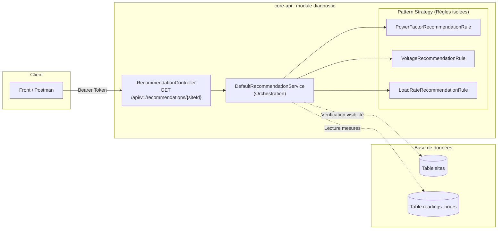

# Recommandations énergétiques


---

## 1. Vue d'ensemble

Disponible uniquement sur le dashboard de détail d'un site.

Le système de recommandations évalue en temps réel la santé et l'efficacité électrique d'un site à partir de sa dernière mesure consolidée dans la table `readings_hours`.

Pour chaque site analysé, l'API fournit une évaluation synthétique sur trois axes fondamentaux :

1. **Le facteur de puissance (cos φ)** : optimisation de l'énergie réactive et prévention des pénalités fournisseurs.
2. **La stabilité de tension (V)** : préservation des matériels contre les sous-tensions et surtensions.
3. **Le taux de charge (%)** : marge de sécurité de l'infrastructure électrique et prévention des surcharges.

---

## 2. Architecture et flux de données



### Principes de conception appliqués

- **Pattern Strategy** : chaque règle de diagnostic implémente l'interface commune `RecommendationRule`. Ajouter un nouvel indicateur ne nécessite aucune modification du service (*Open-Closed Principle*).
- **Ordonnancement garanti** : les règles sont annotées avec `@Order(1)`, `@Order(2)` et `@Order(3)` pour assurer un ordre de restitution immuable dans le tableau JSON.
- **Étanchéité des couches** : aucune entité JPA (`HourlyReading`) n'est exposée au contrôleur ou au client. Seuls des records immuables (`RecommendationResponse`, `RecommendationItemResponse`) transitent.
- **Défense en profondeur** : le service interroge `SiteService.getSite(user, siteId)` afin de vérifier l'existence du site et les droits d'accès de l'utilisateur connecté (`USER` ou `ADMIN`).

---

## 3. Contrat d'API REST

### `GET /api/v1/recommendations/{siteId}`

Récupère les recommandations énergétiques calculées à partir de la dernière mesure horaire du site spécifié.

#### Paramètres

| Paramètre | Type     | Emplacement | Description                                          |
|-----------|----------|-------------|------------------------------------------------------|
| `siteId`  | `String` | Path        | Identifiant unique du site (ex. `SITE001`, `SITE002`) |

#### En-têtes requis

| Header          | Valeur                  | Description                         |
|-----------------|-------------------------|-------------------------------------|
| `Authorization` | `Bearer <access_token>` | Jeton JWT d'authentification valide |

#### Codes de réponse HTTP

| Statut                 | Description                                                                    | Format du corps               |
|------------------------|--------------------------------------------------------------------------------|-------------------------------|
| **`200 OK`**           | Recommandations calculées avec succès                                          | JSON `RecommendationResponse` |
| **`204 No Content`**   | Site existant et visible, mais aucune mesure enregistrée dans `readings_hours` | *Corps vide*                  |
| **`401 Unauthorized`** | Jeton absent, invalide ou expiré                                               | *Standard Spring Security*    |
| **`404 Not Found`**    | Site inexistant ou non autorisé pour cet utilisateur                           | RFC 9457 `ProblemDetail`      |

---

### Exemple de réponse (`200 OK`)

```json
{
  "siteId": "SITE001",
  "timestamp": "2026-10-23T10:00:00Z",
  "items": [
    {
      "type": "POWER_FACTOR",
      "label": "Facteur de puissance",
      "value": 0.96,
      "unit": "",
      "quality": "good",
      "shortRecommendation": "Votre facteur de puissance est excellent. Aucune action n'est requise, votre installation est énergétiquement optimisée.",
      "longRecommendation": "Votre installation présente un excellent facteur de puissance, indiquant une utilisation très efficace de l'énergie électrique. Vous tirez le meilleur parti de vos équipements tout en évitant les pénalités tarifaires de votre fournisseur. Maintenez simplement vos routines de maintenance préventive pour conserver ce niveau de performance sur le long terme."
    },
    {
      "type": "VOLTAGE",
      "label": "Voltage",
      "value": 402.5,
      "unit": "V",
      "quality": "good",
      "shortRecommendation": "Tension stable et optimale. Vos équipements fonctionnent en toute sécurité.",
      "longRecommendation": "La tension de votre réseau est parfaitement stable et reste très proche de sa valeur nominale. Vos appareils électriques opèrent dans leurs conditions de conception idéales, ce qui préserve au maximum leur durée de vie, évite les surchauffes inutiles et garantit une efficacité énergétique maximale."
    },
    {
      "type": "LOAD_RATE",
      "label": "Taux de charge",
      "value": 42.7,
      "unit": "%",
      "quality": "good",
      "shortRecommendation": "Votre taux de charge est optimal. Votre réseau électrique fonctionne en toute sécurité avec une marge confortable.",
      "longRecommendation": "L'intensité appelée par vos équipements est bien en deçà de la limite de votre installation. Vos câbles et disjoncteurs ne subissent aucun stress thermique, ce qui écarte tout risque de coupure par surcharge. Vous disposez d'une réserve de puissance suffisante pour ajouter de nouveaux appareils sans modifier votre infrastructure."
    }
  ]
}
```

---

## 4. Règles de calcul et seuils métier

### 4.1. Facteur de puissance (`POWER_FACTOR`)

- **Grandeur analysée** : valeur brute `power_factor` de la table `readings_hours`.
- **Format** : arrondi à 2 décimales. Unité : `sans unité`.

| Qualité      | Condition          | Version courte | Version longue |
|--------------|--------------------|----------------|----------------|
| **`good`**   | ≥ 0.95             | Votre facteur de puissance est excellent. Aucune action n'est requise, votre installation est énergétiquement optimisée. | Votre installation présente un excellent facteur de puissance, indiquant une utilisation très efficace de l'énergie électrique. Vous tirez le meilleur parti de vos équipements tout en évitant les pénalités tarifaires de votre fournisseur. Maintenez simplement vos routines de maintenance préventive pour conserver ce niveau de performance sur le long terme. |
| **`medium`** | 0.93 à 0.95        | Votre facteur de puissance est acceptable mais perfectible. Surveillez vos équipements pour éviter de glisser vers la zone de pénalité. | Votre facteur de puissance est correct, mais la marge de sécurité avant d'atteindre les seuils de pénalité financière est faible. Il est conseillé d'identifier les charges inductives (moteurs, transformateurs) qui consomment de l'énergie réactive. Optimiser leur utilisation, notamment en évitant de faire tourner des machines à vide ou sous-chargées, vous permettra de repasser dans la zone optimale à moindre coût. |
| **`bad`**    | < 0.93             | Votre facteur de puissance est trop faible et génère des surcoûts. Une intervention technique est nécessaire pour compenser l'énergie réactive. | Votre installation consomme une part trop importante d'énergie réactive, ce qui surcharge votre réseau interne, diminue la durée de vie de vos équipements et déclenche des pénalités sur votre facture d'électricité. Il est vivement recommandé de faire réaliser un audit par un électricien professionnel. L'installation de batteries de condensateurs sera très probablement nécessaire, un investissement généralement vite amorti par les économies directes sur vos factures. |

---

### 4.2. Voltage (`VOLTAGE`)

- **Grandeur analysée** : valeur brute `voltage_v` de la table `readings_hours`.
- **Référence nominale** : **400,0 V** (réseau triphasé industriel standard).
- **Format** : arrondi à 1 décimale. Unité : `"V"`.
- **Calcul de l'écart relatif** :

```text
Écart (%) = (|Tension mesurée - 400| / 400) × 100
```

| Qualité      | Condition             | Plage de tension | Version courte | Version longue |
|--------------|-----------------------|------------------|----------------|----------------|
| **`good`**   | Écart ≤ 5 %           | 380.0 V à 420.0 V | Tension stable et optimale. Vos équipements fonctionnent en toute sécurité. | La tension de votre réseau est parfaitement stable et reste très proche de sa valeur nominale. Vos appareils électriques opèrent dans leurs conditions de conception idéales, ce qui préserve au maximum leur durée de vie, évite les surchauffes inutiles et garantit une efficacité énergétique maximale. |
| **`medium`** | Écart de 5 % à 10 %   | 360.0 V à 380.0 V ou 420.0 V à 440.0 V | Fluctuations de tension détectées. Surveillez l'état de vos équipements électroniques sensibles. | Votre tension présente des variations notables tout en restant à la limite des tolérances acceptables. Bien qu'il n'y ait pas de danger immédiat pour la plupart des machines, ces fluctuations régulières peuvent fatiguer prématurément les composants de vos appareils les plus sensibles. Il est conseillé de surveiller la fréquence de ces écarts. |
| **`bad`**    | Écart > 10 %          | < 360.0 V ou > 440.0 V | Tension critique hors tolérance. Risque élevé de dommages matériels, une intervention est requise. | Les écarts de tension dépassent les seuils de sécurité, ce qui expose directement vos équipements à des risques de pannes, de réinitialisations intempestives ou de dommages irréversibles liés aux sous-tensions ou surtensions. Il est urgent de contacter votre gestionnaire de réseau électrique pour vérifier la distribution, ou d'envisager l'installation d'un régulateur/onduleur pour protéger vos installations. |

---

### 4.3. Taux de charge (`LOAD_RATE`)

- **Grandeur analysée** : intensité mesurée `current_a` de `readings_hours` et capacité active `capacity_kw` de la table `sites`.
- **Format** : arrondi à 1 décimale. Unité : `"%"` (pourcentage).

#### Formules de calcul

1. **Intensité nominale admissible** sous réseau triphasé 400 V avec cos φ de référence standard (0,93) :

```text
I_nominale = (capacityKw × 1000) / (√3 × 400 × 0.93)
```

2. **Taux de charge** :

```text
Taux de charge (%) = (I_mesuré / I_nominale) × 100
```

!!! example "Exemple de calcul"

    Pour un site de 200 kW avec une mesure à 132,5 A :

    ```text
    I_nominale = (200 × 1000) / (√3 × 400 × 0.93) ≈ 310,3 A
    Taux de charge = (132,5 / 310,3) × 100 ≈ 42,7 %  (qualité good)
    ```

| Qualité      | Condition            | Version courte | Version longue |
|--------------|----------------------|----------------|----------------|
| **`good`**   | ≤ 80.0 %             | Votre taux de charge est optimal. Votre réseau électrique fonctionne en toute sécurité avec une marge confortable. | L'intensité appelée par vos équipements est bien en deçà de la limite de votre installation. Vos câbles et disjoncteurs ne subissent aucun stress thermique, ce qui écarte tout risque de coupure par surcharge. Vous disposez d'une réserve de puissance suffisante pour ajouter de nouveaux appareils sans modifier votre infrastructure. |
| **`medium`** | > 80.0 % et ≤ 95.0 % | Taux de charge élevé. Soyez vigilant quant à l'utilisation simultanée de vos gros équipements pour éviter une coupure. | Votre installation s'approche de sa capacité maximale. Si le fonctionnement reste sécurisé, l'activation simultanée de plusieurs appareils énergivores (ou le pic de démarrage de certains moteurs) risque de faire sauter vos disjoncteurs. Il est recommandé de lisser votre consommation en décalant l'utilisation de certaines machines ou de planifier un audit si vous prévoyez d'ajouter de nouveaux équipements. |
| **`bad`**    | > 95.0 %             | Surcharge imminente. Réduisez immédiatement la charge pour éviter un déclenchement ou une surchauffe dangereuse des câbles. | Votre circuit électrique est saturé et fonctionne dangereusement près de sa limite de rupture. Cette situation expose votre installation à des coupures de courant intempestives et à un vieillissement accéléré (voire une surchauffe) du câblage, augmentant les risques d'incendie. Il faut impérativement réduire la charge en éteignant les équipements non essentiels et envisager rapidement un rééquilibrage de vos phases ou une augmentation de la puissance de votre abonnement. |

---

### 4.4. Gestion des capteurs défaillants (`UNKNOWN`)

Si une grandeur mesurée est absente (`null`) dans la dernière ligne de `readings_hours` (panne de capteur ou anomalie de collecte), le système maintient l'item dans la réponse pour signaler le défaut de surveillance :

- **`quality`** : `"unknown"`
- **`value`** : `null`
- **`shortRecommendation`** : `"Données de mesure indisponibles pour ce paramètre."`
- **`longRecommendation`** : `"Les capteurs n'ont pas transmis de données valides pour cette grandeur. Vérifiez la connectivité et l'état de l'équipement de mesure."`
