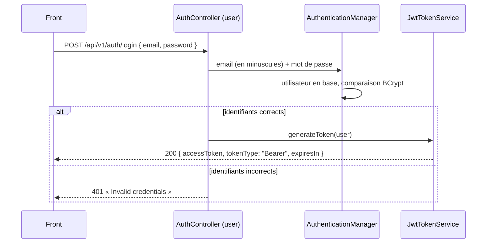

# Sécurité

Authentification **stateless par jeton JWT** (HS256), avec Spring Security en *resource server*. core-api émet lui-même ses jetons (module `user`) et les vérifie sur chaque requête.

## Connexion



Le jeton contient :

| Claim | Valeur |
|---|---|
| `sub` | id de l'utilisateur (UUID) |
| `email` | email |
| `roles` | `["USER"]` ou `["ADMIN"]` |
| `iss` | `enervision-core-api` (vérifié au décodage) |
| `exp` | émission + `JWT_EXPIRATION` (1 h par défaut) |

Il n'y a pas de jeton de renouvellement : à expiration, le front renvoie l'utilisateur vers la page de connexion.

## Règles d'accès

Elles sont posées une fois pour toute l'API dans `SecurityConfig` (module `bootstrap`) :

| Route | Accès |
|---|---|
| `POST /api/v1/auth/login` | Public |
| `/v3/api-docs/**`, `/swagger-ui/**` | Public (désactivés en production) |
| `/error` | Public |
| Tout le reste | Jeton valide obligatoire, sinon **401** |

Un nouvel endpoint, dans n'importe quel module, est donc protégé sans rien ajouter. Une route publique doit être déclarée explicitement dans `SecurityConfig`.

### Rôles

`USER` et `ADMIN` (enum `Role`, module `common`), exposés à Spring Security sous la forme `ROLE_USER` / `ROLE_ADMIN`. Pour réserver un endpoint aux administrateurs : `@AdminOnly` sur la méthode du controller (réponse **403** sinon).

### Visibilité des sites

Un `ADMIN` voit tous les sites ; un `USER` ne voit que les sites qui lui sont attribués dans `users_sites`. Cette règle **n'est pas globale** : chaque module qui renvoie des données liées à un site doit l'appliquer, via `SiteService` (module `configuration`) :

| Méthode | Usage |
|---|---|
| `getSites(user)` | Liste des sites visibles : filtrer une recherche multi-sites |
| `canView(user, siteId)` | Accès à un site donné |
| `getSite(user, siteId)` | Site et profil ; lève une exception « introuvable » si le site n'est pas visible |

Un site non visible répond **404**, comme un site inexistant, pour ne pas révéler son existence.

Exemple simplifié du module `diagnostic` (alertes) :

```java
@GetMapping
public PagedModel<AlertResponse> getAlerts(CurrentUser currentUser, @ParameterObject AlertSearchRequest request, …) {
	return new PagedModel<>(alertService.getAlerts(currentUser, request, page, size));
}

// DefaultAlertService : seules les alertes des sites visibles sont lues
Map<String, String> siteNames = siteService.getSites(user).stream()…;
if (request.siteId() != null && !siteNames.containsKey(request.siteId())) {
	throw new AlertSiteNotFoundException(request.siteId()); // 404
}
```

## Ajouter un endpoint : check-list

1. **Jeton** : rien à faire (`anyRequest().authenticated()`).
2. **Utilisateur courant** : déclarer un paramètre `CurrentUser` dans la méthode du controller ; il est construit à partir du jeton (`sub`, rôle).
3. **Données d'un site** : dépendre du module `configuration` dans le `pom.xml`, puis filtrer avec `SiteService` (voir ci-dessus). C'est le point à ne pas oublier : le module `telemetry` le fait pour les mesures.
4. **Administration** : `@AdminOnly`.
5. **Tests** : un test `@WebMvcTest` sans jeton (401) et un test de service où le site n'est pas visible (404).

## Comptes

Il n'y a pas d'inscription.

- **Premier administrateur** : au démarrage, tant que la table `users` est vide, `InitialAdminInitializer` crée un compte `ADMIN` à partir de `ADMIN_EMAIL` / `ADMIN_PASSWORD` (12 caractères minimum, sinon l'API refuse de démarrer). Avec `ADMIN_EMAIL` vide, rien n'est créé. Une fois un utilisateur en base, ces variables n'ont plus d'effet.
- **En production** : Terraform génère le mot de passe et le range dans SSM avec l'email `admin@<domaine>`. Pour le lire :

    ```bash
    aws ssm get-parameter --with-decryption \
      --name /enervision/prod/env/ADMIN_PASSWORD --query Parameter.Value --output text
    ```

- **Autres comptes** : pour l'instant, insertion directe en base, mot de passe hashé avec le préfixe de son encodeur (`{bcrypt}$2a$10$…`) ; un `USER` a besoin de lignes dans `users_sites` pour voir des sites.

## Secrets

| Variable | Rôle |
|---|---|
| `JWT_SECRET` | Clé HMAC en Base64, 32 octets minimum (`openssl rand -base64 32`), différente par environnement. Sans elle, l'API refuse de démarrer. |
| `JWT_EXPIRATION` | Durée de validité des jetons (`1h` par défaut) |
| `ADMIN_EMAIL`, `ADMIN_PASSWORD` | Premier administrateur (voir ci-dessus) |

En local, ces valeurs sont dans le `.env` racine ; en production, dans SSM Parameter Store (`/enervision/prod/env/`), générées par Terraform et recopiées dans le `.env` de l'EC2 à chaque déploiement.
