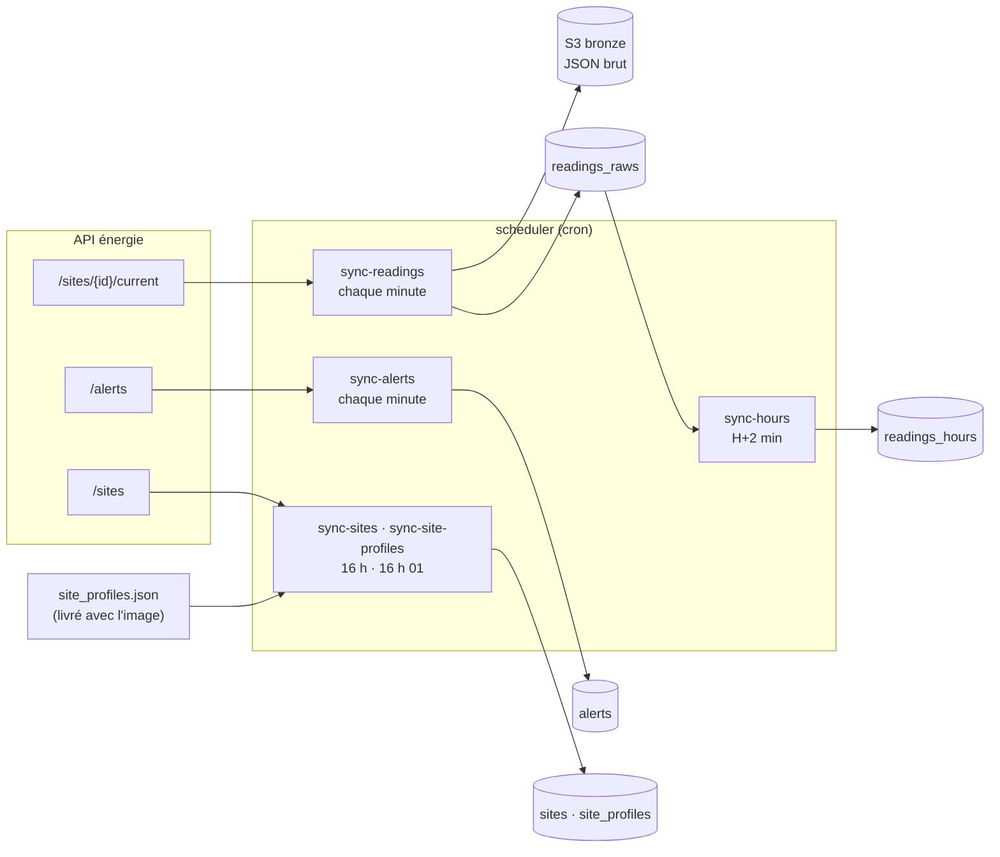

# ETL Worker

Collecte les données de l'API énergie (API Mock de l'école), les archive brutes dans S3 (bronze) et les charge
dans TimescaleDB. Le conteneur `scheduler` exécute les tâches avec cron ; le conteneur `etl-worker` (profil
`manual`) sert aux lancements ponctuels.

## Flux



Seuls `/sites/{id}/current`, `/alerts` et `/sites` sont appelés. `/current` est l'endpoint temps réel prévu par
le sujet ; `/readings` (historique simulé, recalculé à chaque appel) n'est plus utilisé pour la collecte et sera
réservé au rattrapage des minutes manquées.

## Tâches planifiées

Le cron du conteneur est à l'heure de Paris (`TZ=Europe/Paris`) ; les données sont stockées en UTC.

| Tâche | Cron | Rôle |
| --- | --- | --- |
| `sync-readings` | `* * * * *` | Une mesure `/current` par site → bronze S3 puis `readings_raws` |
| `sync-alerts` | `* * * * *` | Alertes actives de `/alerts` → `alerts` (ajout seul) |
| `sync-hours` | `2 * * * *` | Agrégat de l'heure UTC précédente → `readings_hours` |
| `sync-sites` | `0 16 * * *` | Sites de `/sites` → `sites` (ajout ou mise à jour) |
| `sync-site-profiles` | `1 16 * * *` | Profils de `site_profiles.json` → `site_profiles` |

- Chaque tâche passe par `etl-cron-job` (`cron/job.sh`) : un verrou `flock` par tâche empêche deux exécutions
  simultanées (la seconde est ignorée), et les lignes « Début », « Fin » ou « Échec … (code n) » sont écrites
  dans les logs du conteneur.
- Au démarrage (`cron/start.sh`), le conteneur remplit `sites` si la table est vide (`init-sites`) et recharge
  les profils, puis lance cron. Les variables d'environnement utiles sont recopiées dans `/run/etl-worker.env`,
  que cron ne transmet pas sinon.

## Collecte des mesures (`sync-readings`)

1. Les sites sont lus en base (`sites`), pas dans l'API.
2. Pour chaque site : `GET /api/v1/sites/{site_id}/current`. La réponse doit être un objet du même `site_id`
   avec un `timestamp` valide ; sinon, toute la collecte de la minute échoue.
3. Les réponses sont archivées telles quelles dans le bronze, **avant** l'écriture en base.
4. Une copie est insérée dans `readings_raws` avec `ON CONFLICT (site_id, ts) DO NOTHING`.

### Horodatage

- `/current` renvoie un horodatage sans fuseau, à la microseconde : il est lu en **UTC** (vérifié avec l'en-tête
  HTTP `Date`). Un fuseau explicite est converti en UTC.
- En base, `ts` est **ramené au début de sa minute** : une ligne par site et par minute. Une seconde collecte
  dans la même minute (relance manuelle) est ignorée et la première valeur est conservée.
- Le timestamp exact reste dans le bronze.

### Valeurs NULL

Les mesures sont stockées **telles que reçues** : NULL, `null_reasons` et `data_quality` compris. Le sujet le
demande (« un null ignoré est une perte d'information ») et ce sont ces champs qui permettent de mesurer la
fiabilité des capteurs.

| `null_reasons` | Colonnes NULL |
| --- | --- |
| `consumption_sensor_failure` | `consumption_kw`, `consumption_kwh` |
| `electrical_sensor_failure` | `voltage_v`, `current_a`, `power_factor` |
| `temperature_sensor_failure` | `temperature_celsius` |
| `humidity_sensor_failure` | `humidity_percent` |
| `network_loss` | toutes (`data_quality = critical`) |

!!! note "Complétion des consommations"
    `load_readings(..., fill_consumptions=True)` sait remplacer une consommation NULL par la dernière valeur
    connue du site, mais **`sync-readings` ne l'active pas** : elle écrirait la valeur dans la colonne brute,
    sans trace. Elle sera branchée sur une colonne imputée distincte, pour ne jamais écraser un NULL
    (PDF 04 p. 13).

### Bronze S3

Une clé par collecte, horodatée à la microseconde de l'heure de collecte (UTC) :

```
bronze/readings/minutes/date=2026-10-26/hour=09/2026-10-26T09-50-03.059690Z.jsonl
```

Une mesure par ligne (JSON Lines), sans aucune modification. Sans `BRONZE_BUCKET` (poste local), rien n'est
écrit. Un échec d'écriture S3 arrête la tâche avant la base.

## Agrégats horaires (`sync-hours`)

Pour chaque site, l'heure UTC précédente est calculée depuis `readings_raws` puis insérée ou recalculée dans
`readings_hours` :

- `consumption_kwh` = moyenne des `consumption_kw` non NULL × 1 h (`consumption_kw` vaut toujours
  `consumption_kwh` à la minute, ce n'est pas une énergie) ;
- les autres mesures sont des moyennes de leurs valeurs non NULL ;
- un site sans aucune mesure reçoit une ligne dont toutes les valeurs sont NULL ;
- résultats arrondis à 2 décimales.

Rejouer une heure : `etl-worker sync-hours --end-time 2026-10-26T11:00:00+01:00` calcule l'heure qui précède
cette référence.

## Alertes (`sync-alerts`)

`GET /api/v1/alerts`, contrôle des huit champs attendus, puis insertion dans `alerts` avec
`ON CONFLICT (alert_id) DO NOTHING` : une alerte déjà connue n'est jamais modifiée. Le `timestamp` sans fuseau
est lu en UTC. Leur exploitation est décrite dans la documentation de core-api (module `diagnostic`).

## Configuration

| Variable | Rôle |
| --- | --- |
| `DATABASE_URL` | Connexion PostgreSQL (`postgresql://…@db:5432/…`) |
| `ENERGY_API_BASE_URL` | URL de l'API énergie, sans `/api/v1` |
| `ENERGY_API_USERNAME`, `ENERGY_API_PASSWORD` | Authentification Basic, si l'API la demande |
| `BRONZE_BUCKET` | Bucket du data lake ; vide = pas d'archivage (local). En production, fourni par Terraform via SSM |
| `AWS_DEFAULT_REGION` | Région du client S3 |
| `LOG_LEVEL` | Niveau de logs |

## Commandes

```bash
# lancements ponctuels (profil manual)
docker compose run --rm etl-worker sync-readings
docker compose run --rm etl-worker sync-hours --end-time 2026-10-26T11:00:00+01:00
docker compose run --rm etl-worker extract-readings   # affiche les mesures sans rien écrire

# logs de la collecte planifiée
docker compose logs -f scheduler
```

| Commande | Effet |
| --- | --- |
| `init-sites` | Remplit `sites` seulement si la table est vide |
| `sync-sites` | Synchronise `sites` avec l'API |
| `sync-site-profiles` | Charge `site_profiles.json` (jours ouvrés convertis en ISO, lundi = 1) |
| `extract-readings` | Affiche en JSON les mesures `/current`, sans bronze ni base |
| `sync-readings` | Collecte, bronze puis base |
| `sync-hours [--end-time …]` | Calcule une heure de `readings_hours` |
| `etl-sync-alerts` | Collecte et charge les alertes |
| `etl-extract-alerts` | Affiche les alertes en JSON, sans base |

## Vérifier la collecte

```bash
docker compose logs --since 10m scheduler | grep -c "Fin sync-readings"     # ~10 attendu
docker compose logs --since 10m scheduler | grep -c "Échec sync-readings"   # 0 attendu
```

```sql
-- 7 lignes par minute, ts sans secondes
SELECT ts, count(*), count(*) FILTER (WHERE consumption_kw IS NULL) AS conso_null
FROM readings_raws WHERE ts > now() - interval '10 minutes'
GROUP BY ts ORDER BY ts;
```

## Tests

```bash
cd services/etl-worker
ruff check .
python -m pytest tests/
```

Les tests PostgreSQL (`test_load*.py`, `test_transform.py`) ne s'exécutent que si `TEST_DATABASE_URL` est
défini ; chacun travaille dans un schéma temporaire supprimé à la fin. Ils ne sont pas lancés en CI.

## Limites connues

- Une erreur sur un site (HTTP, réseau, réponse invalide) fait échouer la collecte des 7 sites pour la minute.
- Les minutes non collectées (API indisponible, redéploiement) ne sont pas rattrapées : à venir via `/readings`,
  avec une colonne `source` pour distinguer les valeurs rattrapées.
- `sync-hours` ne recalcule que l'heure précédente : une mesure arrivée plus tard n'est prise en compte qu'en
  rejouant l'heure avec `--end-time`.
- Avec `/current`, la part de consommations NULL est nettement plus élevée qu'avec `/readings`
  (environ 15 à 40 % contre 6,6 %, mesuré le 26/10) : c'est le comportement de l'API, pas une perte de données.
