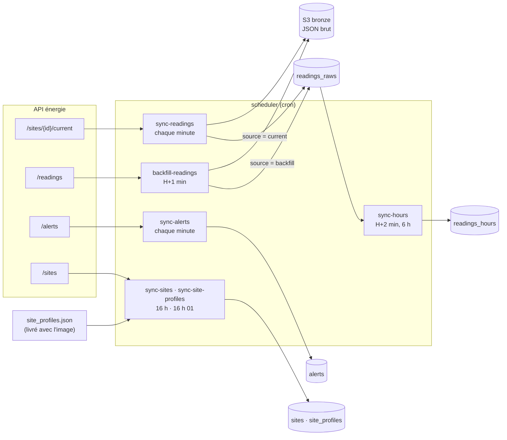

# ETL Worker

Collecte les données de l'API énergie (API Mock de l'école), les archive brutes dans S3 (bronze) et les charge
dans TimescaleDB. Le conteneur `scheduler` exécute les tâches avec cron ; le conteneur `etl-worker` (profil
`manual`) sert aux lancements ponctuels.

## Flux



`/current` est l'endpoint temps réel prévu par le sujet : il alimente la collecte. `/readings` (historique
simulé, recalculé à chaque appel) ne sert qu'au rattrapage des minutes jamais reçues, et chaque valeur rattrapée
est marquée comme telle.

## Tâches planifiées

Le cron du conteneur est à l'heure de Paris (`TZ=Europe/Paris`) ; les données sont stockées en UTC.

| Tâche | Cron | Rôle |
| --- | --- | --- |
| `sync-readings` | `* * * * *` | Une mesure `/current` par site → bronze S3 puis `readings_raws` ; imputation sur 15 min |
| `sync-alerts` | `* * * * *` | Alertes actives de `/alerts` → `alerts` (ajout seul) |
| `backfill-readings` | `1 * * * *` | Minutes sans mesure des 6 dernières heures → `/readings` → bronze puis `readings_raws` ; imputation sur 6 h |
| `sync-hours` | `2 * * * *` | Agrégats des 6 dernières heures UTC → `readings_hours` |
| `sync-sites` | `0 16 * * *` | Sites de `/sites` → `sites` (ajout ou mise à jour) |
| `sync-site-profiles` | `1 16 * * *` | Profils de `site_profiles.json` → `site_profiles` |

- Chaque tâche passe par `etl-cron-job` (`cron/job.sh`) : un verrou `flock` par tâche empêche deux exécutions
  simultanées (la seconde est ignorée), et les lignes « Début », « Fin » ou « Échec … (code n) » sont écrites
  dans les logs du conteneur.
- Au démarrage (`cron/start.sh`), le conteneur remplit `sites` si la table est vide (`init-sites`) et recharge
  les profils, puis lance cron. Les variables d'environnement utiles sont recopiées dans `/run/etl-worker.env`,
  que cron ne transmet pas sinon.

## Collecte des mesures (`sync-readings`)

1. Les sites sont lus en base (`sites`), pas dans l'API.
2. Pour chaque site : `GET /api/v1/sites/{site_id}/current`. La réponse doit être un objet du même `site_id`
   avec un `timestamp` valide.
3. **Chaque site est indépendant** : un site en erreur (HTTP, réseau, réponse invalide) est écrit dans les logs
   d'erreur, les autres sont enregistrés, et la tâche sort en code 1 pour que l'échec apparaisse dans les logs.
   La minute manquée sera rattrapée par `backfill-readings`.
4. Les réponses reçues sont archivées telles quelles dans le bronze, **avant** l'écriture en base.
5. Une copie est insérée dans `readings_raws` avec `source = 'current'` et `ON CONFLICT (site_id, ts) DO NOTHING`.
6. Les consommations NULL des 15 dernières minutes sont imputées (voir plus bas).

```
Mesures reçues : 6/7 ; insérées : 6 ; déjà présentes : 0.
Consommations imputées : 2.
SITE004 : HTTP Error 503: Service Unavailable
```

### Horodatage

- `/current` renvoie un horodatage sans fuseau, à la microseconde : il est lu en **UTC** (vérifié avec l'en-tête
  HTTP `Date`). Un fuseau explicite est converti en UTC.
- En base, `ts` est **ramené au début de sa minute** : une ligne par site et par minute. Une seconde collecte
  dans la même minute (relance manuelle) est ignorée et la première valeur est conservée.
- Le timestamp exact reste dans le bronze.

### Valeurs NULL

Les mesures sont stockées **telles que reçues** : NULL, `null_reasons` et `data_quality` compris. Le sujet le
demande (« un null ignoré est une perte d'information ») et ce sont ces champs qui permettent de mesurer la
fiabilité des capteurs.

| `null_reasons` | Colonnes NULL |
| --- | --- |
| `consumption_sensor_failure` | `consumption_kw`, `consumption_kwh` |
| `electrical_sensor_failure` | `voltage_v`, `current_a`, `power_factor` |
| `temperature_sensor_failure` | `temperature_celsius` |
| `humidity_sensor_failure` | `humidity_percent` |
| `network_loss` | toutes (`data_quality = critical`) |

### Imputation de la consommation

Seule la consommation est imputée, et jamais dans la colonne brute : `consumption_kw` reste NULL, la valeur va
dans `consumption_kw_imputed` avec sa méthode dans `imputation_method` (PDF 04 p. 13 : « ne jamais écraser un
NULL sans traçabilité »). Les autres mesures restent brutes.

| Sites | `imputation_method` | Règle | Sinon |
| --- | --- | --- | --- |
| datacenter, hôpital (consommation stable) | `previous_value` | dernière valeur brute d'au plus 15 min | NULL conservé |
| bureaux, usines, commerce | `linear` | interpolation entre les valeurs brutes qui encadrent la minute, distantes d'au plus 3 min (au plus 2 minutes manquantes, lignes absentes comprises) | NULL, retenté tant que la valeur suivante n'est pas reçue |

- Seules des valeurs brutes servent de base, jamais une valeur déjà imputée.
- Une ligne déjà imputée n'est pas recalculée : l'imputation peut être relancée sans effet.
- Une minute jamais reçue (aucune ligne) n'est pas imputée : elle relève de `backfill-readings`.
- Passages : `sync-readings` sur 15 min, `backfill-readings` sur sa fenêtre (6 h), `impute-readings --hours N`
  à la main.
- Les valeurs imputées servent à l'affichage ; `readings_hours` n'utilise que les valeurs brutes.
- La variation horaire des CSV du sujet (médiane 4,3 % pour le datacenter, 5,0 % pour l'hôpital) borne
  l'erreur d'une valeur reprise sur 15 min à quelques pour cent.

### Origine des mesures (`source`)

| `source` | Provenance | Nature |
| --- | --- | --- |
| `current` | `sync-readings`, `/sites/{id}/current` | mesure prise à l'instant de l'appel |
| `readings` | ancienne collecte via `/readings`, avant le 26/10/2026 09:50 UTC (changeset 005) | valeur recalculée par le simulateur |
| `backfill` | `backfill-readings`, `/readings` | valeur recalculée après coup pour une minute jamais reçue |

Les valeurs `readings` et `backfill` comptent environ 6,6 % de consommations NULL, contre 15 à 40 % pour
`current` : toute statistique de fiabilité des capteurs doit en tenir compte.

### Bronze S3

Une clé par collecte, horodatée à la microseconde de l'heure de collecte (UTC) ; le rattrapage a son propre
dossier, avec le site et la plage dans le nom :

```
bronze/readings/minutes/date=2026-10-26/hour=09/2026-10-26T09-50-03.059690Z.jsonl
bronze/readings/backfill/date=2026-10-26/hour=10/2026-10-26T10-01-02.512345Z_SITE004_20261026T0940-20261026T0952.jsonl
```

Une mesure par ligne (JSON Lines), sans aucune modification. Sans `BRONZE_BUCKET` (poste local), rien n'est
écrit. Un échec d'écriture S3 arrête la tâche avant la base.

## Rattrapage (`backfill-readings`)

1. **Repérer les minutes sans aucune ligne** sur `[maintenant − N h, minute précédente)` (N = 6 par défaut,
   `--hours`), regroupées en plages consécutives par site. Une mesure reçue avec des NULL n'est pas un trou :
   elle n'est jamais remplacée.
2. Pour chaque plage, par morceaux de 1000 minutes au plus :
   `GET /api/v1/readings?site_id&start_time&end_time&limit=<nombre de minutes>`. `limit` doit valoir le nombre
   de minutes, sinon l'API échantillonne la plage ; `end_time` est exclu.
3. **Contrôle** : exactement une mesure du site pour chaque minute attendue, sinon la plage est rejetée.
4. Bronze (dossier `backfill/`), puis insertion avec `source = 'backfill'` et `ON CONFLICT DO NOTHING`.
5. Une plage en erreur n'arrête pas les autres ; elle est retentée au passage suivant et la tâche sort en code 1.
6. Les consommations NULL de la fenêtre sont imputées : une minute rattrapée peut compléter une interpolation
   restée en attente.

En régime normal, aucune minute ne manque et aucun appel à l'API n'est fait.

```
Plages manquantes : 2 ; mesures rattrapées : 61 ; insérées : 61.
```

Pour reconstituer un historique plus long (par exemple 7 jours au premier déploiement) :
`etl-worker backfill-readings --hours 168` puis `etl-worker sync-hours --hours 168`. Après le déploiement du
changeset 005, `etl-worker impute-readings --hours 168` impute l'historique déjà stocké.

## Agrégats horaires (`sync-hours`)

Pour chaque site, les 6 dernières heures UTC (`--hours` pour en changer) sont calculées depuis `readings_raws`
puis insérées ou recalculées dans `readings_hours`, ce qui intègre les minutes comblées par le rattrapage :

- `consumption_kwh` = moyenne des `consumption_kw` non NULL × 1 h (`consumption_kw` vaut toujours
  `consumption_kwh` à la minute, ce n'est pas une énergie) ; les valeurs imputées sont exclues, pour que
  prévisions et scores ne reposent pas sur des données synthétiques ;
- les autres mesures sont des moyennes de leurs valeurs non NULL ;
- un site sans aucune mesure reçoit une ligne dont toutes les valeurs sont NULL ;
- résultats arrondis à 2 décimales ;
- complétude : `minutes_received` (lignes reçues), `minutes_consumption` (dont consommation non NULL) et
  `minutes_backfilled` (dont rattrapées). `minutes_received = 0` signifie qu'aucune mesure n'a été reçue,
  ce qui le distingue d'une panne de capteur. Ces colonnes sont NULL pour les heures calculées avant le
  changeset 005.

Rejouer des heures passées : `etl-worker sync-hours --end-time 2026-10-26T11:00:00+01:00 --hours 1` calcule
l'heure qui précède cette référence.

## Alertes (`sync-alerts`)

`GET /api/v1/alerts`, contrôle des huit champs attendus, puis insertion dans `alerts` avec
`ON CONFLICT (alert_id) DO NOTHING` : une alerte déjà connue n'est jamais modifiée. Le `timestamp` sans fuseau
est lu en UTC. Leur exploitation est décrite dans la documentation de core-api (module `diagnostic`).

## Configuration

| Variable | Rôle |
| --- | --- |
| `DATABASE_URL` | Connexion PostgreSQL (`postgresql://…@db:5432/…`) |
| `ENERGY_API_BASE_URL` | URL de l'API énergie, sans `/api/v1` |
| `ENERGY_API_USERNAME`, `ENERGY_API_PASSWORD` | Authentification Basic, si l'API la demande |
| `BRONZE_BUCKET` | Bucket du data lake ; vide = pas d'archivage (local). En production, fourni par Terraform via SSM |
| `AWS_DEFAULT_REGION` | Région du client S3 |
| `LOG_LEVEL` | Niveau de logs |

## Commandes

```bash
# lancements ponctuels (profil manual)
docker compose run --rm etl-worker sync-readings
docker compose run --rm etl-worker backfill-readings --hours 24
docker compose run --rm etl-worker sync-hours --hours 24
docker compose run --rm etl-worker impute-readings --hours 24
docker compose run --rm etl-worker extract-readings   # affiche les mesures sans rien écrire

# logs de la collecte planifiée
docker compose logs -f scheduler
```

| Commande | Effet |
| --- | --- |
| `init-sites` | Remplit `sites` seulement si la table est vide |
| `sync-sites` | Synchronise `sites` avec l'API |
| `sync-site-profiles` | Charge `site_profiles.json` (jours ouvrés convertis en ISO, lundi = 1) |
| `extract-readings` | Affiche en JSON les mesures `/current`, sans bronze ni base |
| `sync-readings` | Collecte, bronze puis base |
| `backfill-readings [--hours N]` | Rattrape les minutes manquantes des N dernières heures (6 par défaut) |
| `sync-hours [--hours N] [--end-time …]` | Calcule N heures de `readings_hours` (6 par défaut) |
| `impute-readings [--hours N]` | Impute les consommations NULL des N dernières heures (6 par défaut) |
| `etl-sync-alerts` | Collecte et charge les alertes |
| `etl-extract-alerts` | Affiche les alertes en JSON, sans base |

## Vérifier la collecte

```bash
docker compose logs --since 10m scheduler | grep -c "Fin sync-readings"     # ~10 attendu
docker compose logs --since 10m scheduler | grep -c "Échec sync-readings"   # 0 attendu
```

```sql
-- 7 lignes par minute, ts sans secondes
SELECT ts, count(*), count(*) FILTER (WHERE consumption_kw IS NULL) AS conso_null
FROM readings_raws WHERE ts > now() - interval '10 minutes'
GROUP BY ts ORDER BY ts;

-- répartition par origine sur 24 h
SELECT source, count(*), round(100.0 * count(*) FILTER (WHERE consumption_kw IS NULL) / count(*), 1) AS pct_null
FROM readings_raws WHERE ts > now() - interval '24 hours' GROUP BY source;

-- imputations sur 24 h
SELECT imputation_method, count(*)
FROM readings_raws WHERE ts > now() - interval '24 hours' AND consumption_kw IS NULL
GROUP BY imputation_method;

-- complétude des dernières heures
SELECT site_id, ts, minutes_received, minutes_consumption, minutes_backfilled
FROM readings_hours ORDER BY ts DESC, site_id LIMIT 14;
```

## Tests

```bash
cd services/etl-worker
ruff check .
python -m pytest tests/
```

Les tests PostgreSQL (`test_load*.py`, `test_transform.py`, `test_impute.py`) ne s'exécutent que si `TEST_DATABASE_URL` est
défini ; chacun travaille dans un schéma temporaire supprimé à la fin. Ils ne sont pas lancés en CI.

## Limites connues

- Les valeurs rattrapées sont simulées après coup par l'API : elles complètent les séries mais ne sont pas des
  mesures d'époque (d'où `source = 'backfill'`).
- Au-delà de 6 heures, une minute manquée n'est plus rattrapée automatiquement (lancer `--hours` à la main).
- Une panne de capteur de plus de 15 min (datacenter, hôpital) ou de plus de 2 minutes (autres sites) reste
  NULL : c'est voulu, le dashboard doit la montrer.
- Avec `/current`, la part de consommations NULL est nettement plus élevée qu'avec `/readings`
  (environ 15 à 40 % contre 6,6 %, mesuré le 26/10) : c'est le comportement de l'API, pas une perte de données.
