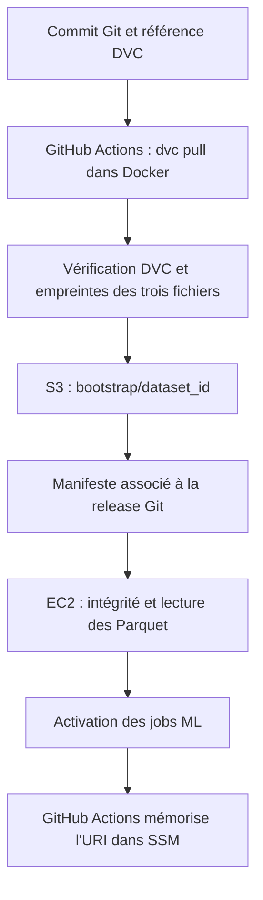

#Versionnement DVC et déploiement des datasets

DVC associe les trois Parquet historiques à une version du code. Git conserve leur
référence dans `ml-datasets.dvc` ; le contenu des fichiers est stocké dans S3.
La génération des Parquet reste effectuée par le
script de préparation Python.

Les commandes de cette page s'exécutent **depuis la racine du dépôt, sous Linux ou
WSL**. La récupération DVC et le lancement des expériences sont deux commandes
distinctes.

##Ce qui est versionné

Le dossier `.data/ml/splits/` est suivi comme un ensemble contenant exactement :

- `train.parquet` ;
- `validation.parquet` ;
- `test.parquet`.

Un changement de l'un de ces fichiers produit une nouvelle référence de dataset.
Les Parquet, le CSV original et le cache local restent ignorés par Git.

| Élément                                    | Rôle                                                                                          |
|--------------------------------------------|-----------------------------------------------------------------------------------------------|
| `ml-datasets.dvc`                          | Empreinte du répertoire, taille totale et nombre de fichiers ; versionné avec le code.        |
| `.dvc/config`                              | Remote S3 `datasets`, région et cache local configuré en copie.                               |
| `.dvc/cache/`                              | Copie locale des objets DVC ; ignorée par Git et les contextes Docker à la racine.            |
| `services/ml-service/run_dvc.py`           | Lanceur Python standard qui construit puis exécute l'outil Docker DVC.                        |
| `services/ml-service/Dockerfile.dvc-tools` | Image `enervision-dvc:local`, avec les versions DVC et S3 fixées dans `requirements-dvc.txt`. |

DVC ne transfère pas les expériences MLflow. Chaque serveur MLflow conserve ses
propres runs et artefacts. Versionner `test.parquet` ne lance aucune évaluation :
le [lanceur des 96 essais](entrainement.md#lancer-la-campagne) continue à utiliser
uniquement train et validation.

### Stockage dans S3

Le bucket datalake existant contient des préfixes distincts :

| Préfixe                               | Contenu et utilisation                                       |
|---------------------------------------|--------------------------------------------------------------|
| `bronze/readings/`                    | Mesures brutes archivées par l'ETL.                          |
| `mlflow/artifacts/`                   | Artefacts du serveur MLflow de production.                   |
| `ml/datasets/dvc/`                    | Objets DVC identifiés par leurs empreintes.                  |
| `ml/datasets/bootstrap/<dataset_id>/` | Snapshot vérifié, consommable par le chargeur de production. |

L'URL réelle du remote est déjà enregistrée dans `.dvc/config`. Un collègue qui
récupère le dépôt n'a pas besoin de refaire `dvc init` ou de créer un remote.

## Récupérer les Parquet en local

### Prérequis et connexion AWS

Il faut Git, Python 3.12 ou plus, Docker démarré et un accès AWS au bucket.
Aucun venv DVC ni démarrage de PostgreSQL ou de MLflow n'est nécessaire pour
récupérer les données.

Avec le profil SSO `enervision` déjà configuré sur le poste :

```bash
aws sso login --profile enervision
aws sts get-caller-identity --profile enervision
```

Si le profil n'existe pas encore, le configurer avec les informations SSO de
l'organisation :

```bash
aws configure sso --profile enervision
```

Le profil personnel peut porter un autre nom : adapter `--profile`. Le lanceur monte
`~/.aws` en lecture seule dans le conteneur. Une session expirée se renouvelle sur
le poste avec `aws sso login`. Les identifiants restent hors de Git et de l'image.

### Télécharger la version référencée par le code

Après avoir récupéré la branche ou le commit souhaité :

```bash
python3 services/ml-service/run_dvc.py pull --profile enervision
python3 services/ml-service/run_dvc.py status
```

`pull` récupère les trois fichiers et les place dans `.data/ml/splits/`.
Il n'a besoin ni du CSV ni des métadonnées des sites. Il ne régénère pas les données.
`status` compare le dossier local à la référence DVC et affiche
`Data and pipelines are up to date.` lorsque les fichiers correspondent.

Le lanceur construit l'image à chaque commande en réutilisant le cache Docker.
L'utilisateur du conteneur correspond à l'UID/GID du poste pour conserver les droits
sur les fichiers créés. Le conteneur est supprimé après son exécution.

Pour vérifier la version de l'outil ou prévisualiser une commande :

```bash
python3 services/ml-service/run_dvc.py version
python3 services/ml-service/run_dvc.py pull --profile enervision --dry-run
```

`--dry-run` affiche les commandes sans les exécuter. Le paramètre `--aws-dir`
permet d'indiquer un autre dossier de configuration AWS si nécessaire.

### Lancer ensuite les expériences

```bash
python3 services/ml-service/run_experiments.py
```

Ce lanceur réutilise les Parquet récupérés. Il n'exécute pas `dvc pull` lui-même.
Le déroulement et les métriques sont détaillés dans
[Entraînement et MLflow](entrainement.md).

## Publier une nouvelle version des données

Travailler sur une branche dédiée. Générer les Parquet avec le script Python
uniquement lorsqu'une nouvelle préparation est voulue, puis enregistrer les trois
fichiers ensemble :

```bash
python3 services/ml-service/run_dvc.py status
python3 services/ml-service/run_dvc.py add
python3 services/ml-service/run_dvc.py push --profile enervision
git diff -- ml-datasets.dvc
```

- `status` montre les différences avant leur enregistrement.
- `add` met à jour le cache et la référence, avec `--no-relink` pour conserver les
  fichiers sources en place. Le dossier doit contenir exactement les trois Parquet.
- `push` envoie les objets au remote S3.

Après vérification, enregistrer la référence dans Git :

```bash
git add ml-datasets.dvc
git commit -m "chore(ml): versionner les nouveaux Parquet"
```

Inclure également le code de préparation si sa logique a changé, puis pousser la
branche et ouvrir une PR. **Le `dvc push` doit réussir avant de partager la référence
Git** : sinon un collègue ou la pipeline ne pourra pas récupérer les objets manquants.

### Retrouver une ancienne version

Sauvegarder les modifications locales du code et des Parquet avant de changer de
version. Dans l'exemple suivant, remplacer `REF_DU_COMMIT` par une révision contenant
le lanceur et les métadonnées DVC :

```bash
git switch --detach REF_DU_COMMIT
python3 services/ml-service/run_dvc.py pull --profile enervision
python3 services/ml-service/run_dvc.py status
```

Le commit choisit le code et la référence ; DVC restitue les données correspondantes.
Un `git pull` seul ne télécharge pas les Parquet. Conserver les objets des versions
encore utiles dans S3 ; aucun nettoyage distant DVC n'est lancé par ce parcours.

## Intégration à la pipeline de production

La version sélectionnée est celle de `ml-datasets.dvc` dans le **commit déployé**.
Le workflow `Deploy`, dans `.github/workflows/services.yml`, traite les données
lorsque `prediction-service` fait partie des services sélectionnés. Sa sélection
entraîne également le déploiement de `prediction-jobs`.

Une modification de la référence DVC, de sa configuration ou des outils associés
est reliée à ce service dans `.github/services.json`. Un changement de dataset seul
reconstruit actuellement aussi son image. Les changements sont comparés au dernier
commit déployé avec succès, enregistré dans SSM.

Le job est associé à l'environnement GitHub `production`. Les reviewers requis
doivent être configurés dans cet environnement pour imposer une validation manuelle.
GitHub Actions utilise le rôle AWS temporaire obtenu par OIDC, sans profil SSO
personnel ni clés AWS permanentes ajoutées au dépôt.



### Publication et traçabilité

`infra/deploy/dataset_release.py prepare`, exécuté dans l'image DVC après `pull`,
vérifie la référence, le manifeste du cache, les trois contenus et leurs tailles.
Il prépare `.data/ml/dataset-release.json`, qui associe :

- le commit Git ;
- l'identifiant DVC du répertoire, suffixé par `.dir` ;
- le bucket et l'URI du snapshot ;
- la taille et l'empreinte SHA-256 de chaque Parquet.

`scripts/ml/upload-bootstrap.sh --release <manifeste-json>` publie ensuite les
trois Parquet dans `ml/datasets/bootstrap/<dataset_id>/`, avec `sha256.txt` et
`manifest.json`. Le manifeste de snapshot est écrit en dernier, une fois les fichiers
vérifiés. Il ne dépend pas du commit Git : plusieurs releases peuvent réutiliser les
mêmes données.

Un objet existant et identique est réutilisé. Un envoi interrompu peut reprendre.
Un contenu différent sous la même référence provoque un échec ; les écritures
conditionnelles S3 empêchent un écrasement concurrent.

Le manifeste de release est copié dans le bucket de déploiement sous
`releases/<commit>/dataset-release.json`, puis transmis à l'EC2 avec les fichiers
de déploiement.

### Activation sur l'EC2

`infra/deploy/deploy.sh` vérifie le commit et les empreintes du snapshot distant.
Il prépare ensuite `TRAINING_BOOTSTRAP_URI` dans `deploy.env`, associé à la release.
Cette valeur prend priorité sur celle du `.env` construit depuis SSM.

Avant le redémarrage, un conteneur ponctuel appelle le chargeur existant
`prediction_service.datasets.load_bootstrap`. Cette lecture vérifie notamment les
colonnes, les cibles et la séparation chronologique, sans entraîner de modèle.
Après activation, le script contrôle l'URI effective de `prediction-jobs`.

En cas d'échec de l'activation ou du contrôle, le script tente de restaurer l'ancien
tag ML et l'ancienne URI. Lors d'un premier déploiement sans ancien tag connu, les
nouveaux jobs sont arrêtés. Une erreur de restauration est signalée dans les logs.

Après le succès du déploiement sur l'EC2, GitHub Actions met à jour puis relit
`/enervision/prod/env/TRAINING_BOOTSTRAP_URI` dans SSM. Si cette dernière étape échoue,
la configuration locale de la release conserve son URI ; corriger l'erreur puis
relancer le workflow pour remettre SSM en cohérence.

Le chargeur de production continue à lire directement les fichiers
`train.parquet`, `validation.parquet` et `test.parquet` du snapshot S3.
Le remote DVC contient des objets nommés par empreinte : **son URL ne doit pas être
utilisée directement comme `TRAINING_BOOTSTRAP_URI`**.

DVC s'exécute dans la pipeline, pas dans un service permanent sur l'EC2.
Les jobs habituels restent responsables des entraînements et des prévisions.
La publication d'un dataset ne sélectionne pas immédiatement un nouveau champion.

## Première activation en production

L'intégration devient active après application des prérequis Terraform et déploiement
du code concerné. Le workflow Deploy n'applique pas Terraform.

Le rôle GitHub doit disposer de la lecture du préfixe DVC, de la lecture/écriture
des snapshots bootstrap et de la lecture/écriture du paramètre SSM concerné.
Le rôle EC2 conserve la lecture des datasets.

Terraform déplace le paramètre existant vers
`aws_ssm_parameter.training_bootstrap_uri` avec un bloc `moved`.
Il ignore ensuite les changements de sa valeur, pilotée par la pipeline :
un futur `terraform apply` ne rétablit donc pas automatiquement `bootstrap/v1`.

### Préparer et relire Terraform

Faire valider la PR par la CI. Pour travailler depuis un poste, récupérer la
configuration **réelle de production** utilisée par l'équipe. Les fichiers
`infra/terraform/backend.hcl` et `infra/terraform/terraform.tfvars` sont ignorés
par Git ; leurs exemples sont des points de départ à renseigner.

Ces fichiers sont une façon de fournir la configuration, pas une obligation :
le backend peut aussi être renseigné par options, et les variables par
`TF_VAR_...`. La CI utilise déjà ces alternatives. Il faut retrouver le même
état S3 et les mêmes paramètres de production.

Avec ces fichiers validés, depuis la racine :

```bash
export AWS_PROFILE=enervision
cd infra/terraform
terraform init -backend-config=backend.hcl
terraform validate

plan_dir=$(mktemp -d)
terraform plan -var-file=terraform.tfvars -out="$plan_dir/dvc.tfplan"
terraform show "$plan_dir/dvc.tfplan"
```

`init` configure l'accès à l'état partagé. `validate` contrôle la configuration.
`plan` prépare les changements dans un dossier temporaire et `show` les affiche.
Vérifier notamment le déplacement du paramètre SSM, sans suppression ni recréation
de celui qui existe déjà.

L'application suivante est une **action manuelle sur l'infrastructure de production**.
La lancer dans le même terminal, uniquement après validation du plan :

```bash
terraform apply "$plan_dir/dvc.tfplan"
```

### Déployer la version choisie

Une fois les prérequis appliqués et le code fusionné sur `main`, lancer le workflow
ciblé depuis la racine, avec GitHub CLI connecté :

```bash
gh workflow run services.yml --ref main -f services=prediction-service
```

On peut également passer par **Actions → Deploy → Run workflow**, sélectionner
`main` et renseigner `services=prediction-service`. Approuver ensuite le job de
production selon les règles de l'équipe.

Les changements du workflow ou de `.github/services.json` sont classés comme globaux :
le premier lancement automatique peut sélectionner tous les services. S'il est en
attente et qu'un déploiement ML ciblé est prévu, annuler ce lancement avant de démarrer
celui ciblé. Ne valider le déploiement qu'après préparation des permissions Terraform.

## Vérifications et diagnostic

Les tests suivants utilisent des outils factices ou un stockage en mémoire.
Ils ne publient aucun snapshot réel et ne déploient aucun service :

```bash
python3 -B -m unittest discover -s scripts/ml/tests -v
python3 -B -m unittest discover -s services/ml-service/tests -p 'test_run_*.py' -v
```

Les tests de publication et de déploiement sont également exécutés par Infra CI.

| Symptôme                                   | Vérification                                                                                                                              |
|--------------------------------------------|-------------------------------------------------------------------------------------------------------------------------------------------|
| Session SSO expirée                        | Relancer `aws sso login --profile enervision` sur le poste.                                                                               |
| Accès S3 refusé                            | Vérifier le rôle utilisé et les permissions sur les préfixes DVC ou bootstrap.                                                            |
| Objets DVC manquants                       | Le producteur doit terminer `dvc push` avant de partager le commit de référence.                                                          |
| Parquet différents en local                | Choisir entre enregistrer une nouvelle version avec `add` et `push`, ou récupérer la référence voulue après sauvegarde des modifications. |
| Snapshot ou empreinte refusé               | Consulter l'erreur du helper ; aucun contenu distant différent n'est écrasé automatiquement.                                              |
| Lecture de validation impossible sur l'EC2 | Examiner les logs du déploiement, les droits S3 et la compatibilité des colonnes avec le chargeur existant.                               |
| Écriture SSM échouée après activation      | Vérifier les droits du rôle GitHub, puis relancer le workflow ; le snapshot publié peut être réutilisé.                                   |
| Modèles MLflow absents sur un autre poste  | DVC partage les datasets ; les runs et modèles nécessitent le serveur MLflow approprié.                                                   |
