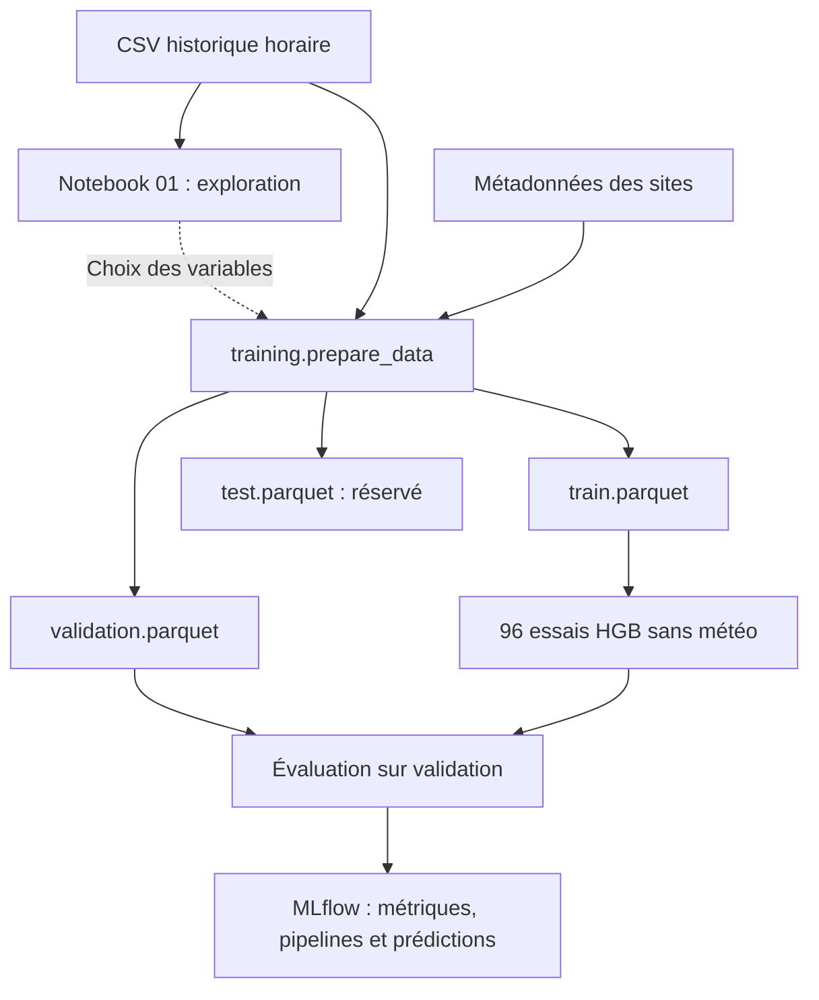

# ML Service

Le module entraîne et compare des modèles de prévision de consommation horaire en kWh,
communs aux sept sites. Chaque prédiction concerne un site et une heure ; la cible est
`consumption_kwh`. Le site fait partie des entrées du modèle.

La campagne actuelle compare **96 essais HistGradientBoosting sans météo** : quatre
variantes de lags, avec les mêmes 24 configurations d'hyperparamètres pour chacune.
Elle utilise uniquement les fichiers train et validation existants.

- [Données et préparation](donnees.md) : sources, choix des variables et création des Parquet.
- [Versionnement DVC](dvc.md) : récupération des Parquet, publication et intégration à la production.
- [Entraînement et MLflow](entrainement.md) : lancement, comparaison et reprise d'une campagne.

## Flux de travail

Le notebook sert à explorer les données et à justifier les décisions. La génération des
Parquet et les entraînements sont effectués par les scripts Python.

Le parcours d'entraînement part des fichiers historiques locaux : il ne collecte pas
les données de l'API, ne lit pas automatiquement le bronze S3 et ne modifie pas l'ETL.
La planification des prédictions et la promotion d'un champion ne sont pas exécutées
par le lanceur.

## Rôle des fichiers

Les chemins ci-dessous sont relatifs à `services/ml-service/`.

| Fichier                                            | Rôle                                                                                               |
|----------------------------------------------------|----------------------------------------------------------------------------------------------------|
| `notebook/01_exploration_consommation.ipynb`       | Exploration, tableaux, graphiques et justification des variables.                                  |
| `notebook/02_recalage_niveau_prod.ipynb`           | Backtest du recalage de niveau sur les heures mesurées en production (export : `scripts/ml/export-prod-hours.sh`). |
| `requirements-notebooks.txt`                       | Dépendances de l'environnement d'exploration.                                                      |
| `training/prepare_data.py`                         | Vérification du CSV, recalcul des horaires travaillés, création des lags et des trois Parquet.     |
| `training/data.py`                                 | Schéma des données et lecture exclusive de train et validation pendant les expériences.            |
| `training/models.py`                               | Pipeline de prétraitement et estimateur HGB ou Ridge.                                              |
| `training/train.py`                                | Entraînement d'un essai sur train, évaluation sur validation et vérification du modèle sauvegardé. |
| `training/metrics.py`                              | MAE, RMSE, R² et nMAE, globalement et par site.                                                    |
| `training/tracking.py`                             | Connexion MLflow, provenance, paramètres, jeux de données et pipeline.                             |
| `training/search_hgb.py`                           | Grille, exécution des essais, reprise et bilan de campagne.                                        |
| `configs/hist_gradient_boosting_no_weather.yaml`   | Modèle de base, expérience et paramètres fixes de la campagne actuelle.                            |
| `configs/hgb_search_no_weather.yaml`               | Quatre variantes de variables et grille des 24 configurations.                                     |
| `run_experiments.py`                               | Commande unique : vérifications, image Docker, démarrage de MLflow et 96 essais.                   |
| `run_dvc.py`                                       | Versionnement et récupération des trois Parquet avec DVC dans Docker.                              |
| `Dockerfile.dvc-tools`, `requirements-dvc.txt`     | Image et versions des dépendances DVC/S3.                                                          |
| `Dockerfile.training`, `requirements-training.txt` | Image Python et versions des dépendances d'entraînement.                                           |
| `compose.training.yaml`                            | Services `ml-trainer` et `ml-prepare`, montages et limites de ressources.                          |
| `mlflow/`                                          | Serveur, initialisation de sa base PostgreSQL et configuration des artefacts.                      |
| `tests/`                                           | Contrôles de la préparation, du lanceur et du plan d'expériences.                                  |
| `training/export.py`                               | Export manuel d'un run sklearn pour le service de prédiction ; hors du parcours des 96 essais.     |

La référence `ml-datasets.dvc` et la configuration `.dvc/` sont à la racine du dépôt.
Le parcours de déploiement des datasets est décrit dans la [page DVC](dvc.md#integration-a-la-pipeline-de-production).

Les anciennes configurations Ridge et HGB avec météo restent disponibles pour retrouver
les expériences précédentes. Le lanceur actuel sélectionne la configuration sans météo.

## Stockage local

| Élément                           | Emplacement et contenu                                                                                                                  |
|-----------------------------------|-----------------------------------------------------------------------------------------------------------------------------------------|
| Sources et Parquet                | `.data/ml/`, ignoré par Git ; sources à fournir pour la préparation, Parquet partagés via DVC.                                          |
| Base MLflow                       | Base et utilisateur dédiés dans le conteneur PostgreSQL existant : expériences, runs, paramètres, métriques et métadonnées des modèles. |
| Artefacts MLflow                  | Volume Docker `mlflow_artifacts` : pipelines, configurations, prédictions et rapports JSON.                                             |
| Dépendances Python d'entraînement | Image Docker `enervision-ml-trainer:local`.                                                                                             |

Récupérer le dépôt Git ne récupère pas les runs ni les modèles d'un autre poste.
Deux serveurs MLflow locaux ont des historiques distincts. Une désignation de champion
commune à l'équipe doit se faire sur une instance MLflow partagée.
